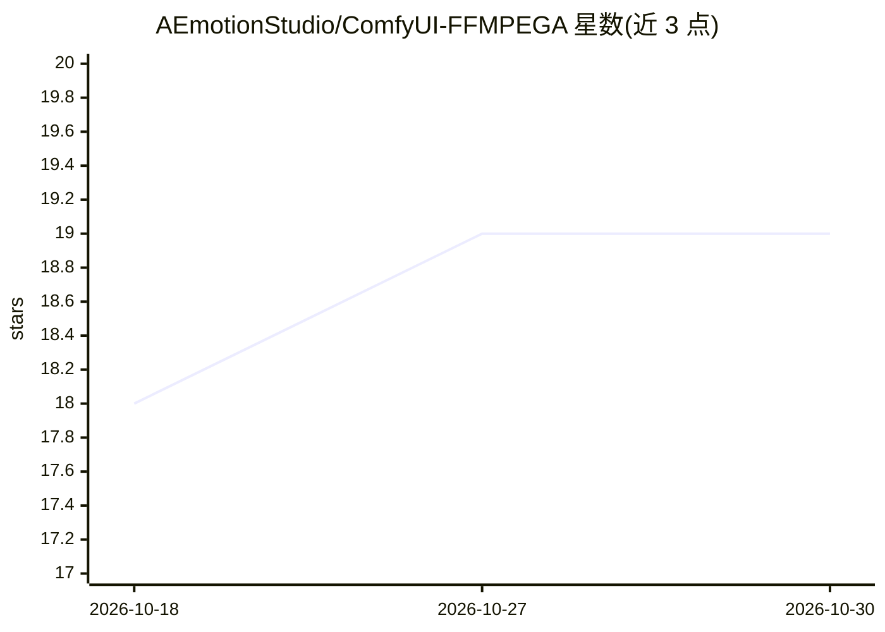

# AEmotionStudio/ComfyUI-FFMPEGA

⭐ 19 · Python · GPL-3.0 · 推送 2026-10-22 · [GitHub](https://github.com/AEmotionStudio/ComfyUI-FFMPEGA) · [官网](https://aemotionstudio.org/) · 组织维护

**ComfyUI 自然语言视频编辑节点套件：AI 生成 FFmpeg 流水线**

运行在 ComfyUI 内的视频编辑节点集：核心的 FFMPEG Agent 节点用 LLM 解析自然语言指令，自动构建并执行 FFmpeg 流水线；同时提供不依赖 LLM 的 Effects Builder 手动模式与文本预设。LLM 侧支持 Ollama 与 OpenAI 兼容服务器（LM Studio、llama.cpp、vLLM）及多个 CLI 工具。内置 200+ 视频编辑技能，部分技能调用自动下载的 AI 模型（SAM3、Whisper、LivePortrait 等），模型镜像到自有 HuggingFace 仓库。需 ComfyUI、Python 3.10+、FFmpeg，可经 ComfyUI Manager 或 git clone 安装。

## 筛选速览

| 维度 | 判定 | 备注 |
|---|---|---|
| AI 角色 | `ai-enhanced` | 去掉 AI 部分产品仍成立 |
| 许可风险 | `dual` | GPL-3.0 |
| 部署形态 | `library` | 以包/库形式分发 |
| 模型依赖 | local-ok | 支持本地模型 |
| 硬件要求 | — | 无带数字的原话,不猜 |
| 安装摩擦 | `medium` | 含编译或系统依赖之一 |
| 成熟度 | — | 结构信号不足 |

## 能力要点

- 自然语言指令由 AI agent 映射为 FFmpeg 流水线并执行
- 200+ 视频编辑技能，含转写、遮罩、抠像、唇形同步等 AI 技能
- 支持 Ollama 与 OpenAI 兼容本地服务器，也可完全无 LLM 手动编辑
- AI 模型首次使用自动下载，镜像至 AEmotionStudio HuggingFace 仓库

## 适用场景

- 在 ComfyUI 工作流中用一句话完成视频调色、变速、字幕等编辑
- 批量对多个视频应用同一编辑指令并先出低清预览
- 不写代码为视频叠加文字、Logo、分屏与转场效果

## 场景标签

`图像视频处理` · 领域:感知与多模态

## 证据(README 行号)

> L59: Describe edits in plain text: *"Make it cinematic with a fade in"*, *"Speed up 2x"*, *"VHS look with grain"*. The A
> L61: ### 🏗️ Manual Mode — No AI Required
> L65: Works with **Ollama** and **OpenAI-compatible local servers** (LM Studio, Unsloth Studio, llama.cpp, vLLM), plus **

## 星数曲线

2026-10-18 18 → 2026-10-30 19（+1）

---
*卡片 v1 · prompt 1.4 · 生成 2026-10-29 · 置信度 mid · 依据 README sha `99f2c6758f13` · [字段定义](../../DATASET.md)*
