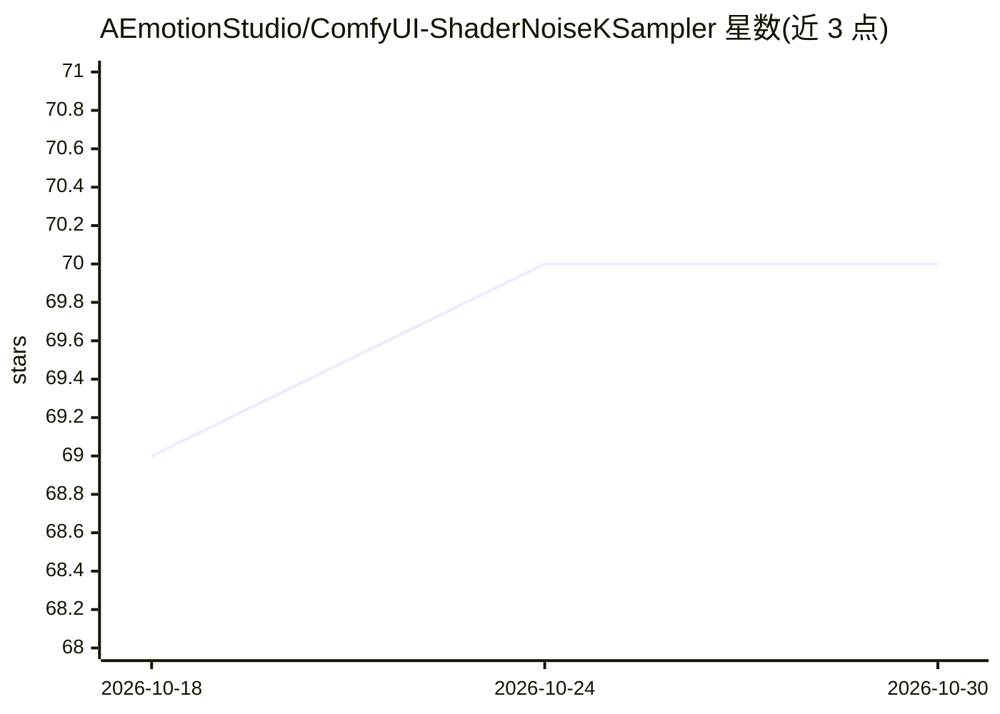

# AEmotionStudio/ComfyUI-ShaderNoiseKSampler

⭐ 70 · Python · GPL-3.0 · 推送 2026-10-29 · [GitHub](https://github.com/AEmotionStudio/ComfyUI-ShaderNoiseKSampler) · [官网](https://aemotionstudio.org/) · 组织维护

**ComfyUI 自定义 KSampler 节点：用着色器噪声定向探索潜空间**

ComfyUI 的高级 KSampler 替换节点，将标准随机噪声与多阶段着色器噪声系统混合，在固定种子邻域内沿数学模式连贯地探索潜空间，而非在种子间随机跳转。提供 13 种着色器噪声类型、形状遮罩、配色方案、混合模式、分阶段注入、旅行模式（walk/drift/jump）、批内参数递增（Shader Noise Walk）与拆分采样等输入。自 2.0.0 起推荐使用 Direct 节点（参数全部为节点输入、无需保存），旧节点已弃用但仍可在既有工作流中加载。以形状而非模型列表判定兼容，支持任意图像/视频潜变量。面向使用 ComfyUI 的图像生成创作者与研究者。

## 筛选速览

| 维度 | 判定 | 备注 |
|---|---|---|
| AI 角色 | `ai-ecosystem` | LLM/agent 周边工具 |
| 许可风险 | `viral` | GPL-3.0 |
| 部署形态 | `library` | 以包/库形式分发 |
| 模型依赖 | — | README 未给出锁定关系 |
| 硬件要求 | — | 无带数字的原话,不猜 |
| 安装摩擦 | `low` | 无编译、无系统依赖或容器化 |
| 成熟度 | — | 结构信号不足 |

## 能力要点

- 13 种着色器噪声类型，各支持形状遮罩、配色与变换
- Direct 节点将全部着色器参数作为节点输入并带实时预览
- 分阶段注入、拆分采样与 Shader Noise Source 自定义采样
- 按潜变量形状判定兼容，支持图像/视频/多流（如 MiniMax H3）潜变量

## 适用场景

- 固定种子后系统性地探索其邻域的图像变体
- 在动画生成中保持帧间一致的演化噪声
- 批量递增单一着色器参数做 A/B 对比实验

## 场景标签

`图像生成` · 领域:内容生成

## 证据(README 行号)

> L10: ComfyUI-ShaderNoiseKSampler is an advanced custom KSampler node that blends standard noise generation with a multi-
> L99: - **🚀 Advanced KSampler Replacement**: Integrates directly into your workflow as a KSampler.

## 星数曲线

2026-10-18 69 → 2026-10-30 70（+1）

---
*卡片 v1 · prompt 1.4 · 生成 2026-10-24 · 置信度 mid · 依据 README sha `113bb7ceb2f7` · [字段定义](../../DATASET.md)*
