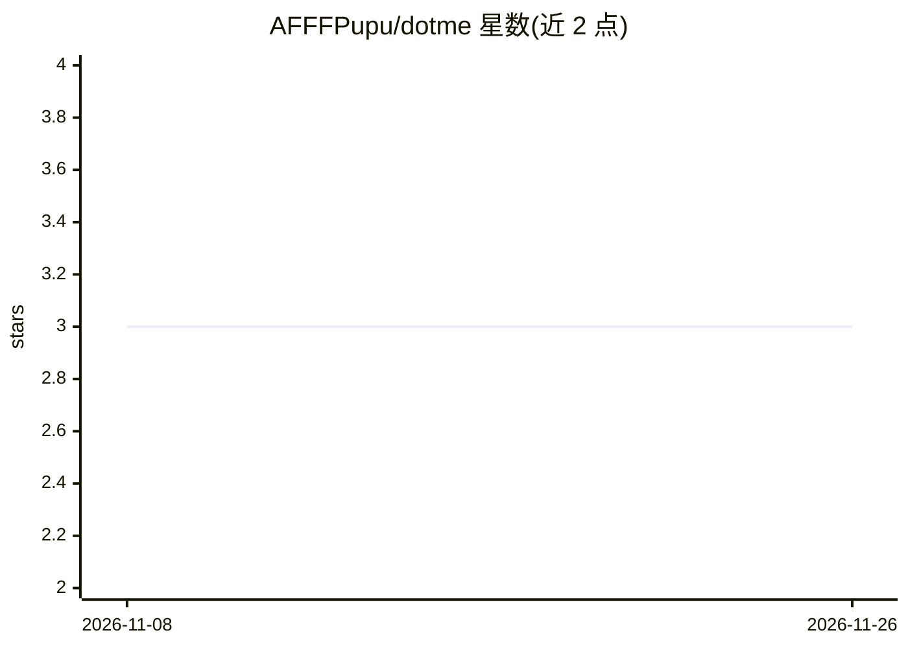

# AFFFPupu/dotme

⭐ 3 · TypeScript · MIT · 推送 2026-11-05 · [GitHub](https://github.com/AFFFPupu/dotme) · [官网](https://github.com/AFFFPupu/dotme#readme) · 个人维护

**给 AI agent 的自托管偏好仓库：一处存储、各 agent 经 MCP 共读**

自托管在 Cloudflare Workers 上的偏好管理服务：用户偏好以 Markdown 存放在自己的 GitHub 私有仓库，各 AI agent 通过一个 MCP server 读取；agent 发现新偏好时通过 propose_change 工具提交提案，经用户批准（客户端对话框或手机网页）后以 commit 形式落库。提供 Claude Code/Codex 插件与会话钩子、`/dotme-import` 与 `/dotme-review` 两个 skill、按类别细分读写权限及 passkey/OAuth 安全机制。安装需 GitHub 与 Cloudflare 账号，由 agent 按 INSTALL.md 引导完成。

## 筛选速览

| 维度 | 判定 | 备注 |
|---|---|---|
| AI 角色 | `ai-ecosystem` | LLM/agent 周边工具 |
| 许可风险 | `permissive` | MIT |
| 部署形态 | `library` | 以包/库形式分发 |
| 模型依赖 | — | README 未给出锁定关系 |
| 硬件要求 | — | 无带数字的原话,不猜 |
| 安装摩擦 | `low` | 无编译、无系统依赖或容器化 |
| 成熟度 | — | 结构信号不足 |

## 能力要点

- 偏好存为自有 GitHub 私有仓库中的 Markdown，每次变更都是带证据的 commit
- agent 提案、用户批准的写入流程，支持手机端 Face ID/Touch ID 批准
- 提供 MCP 工具集：get_preferences、propose_change、list_pending 等 5 个工具
- 按类别（collab/coding/life）控制各连接的可见范围

## 适用场景

- 让 Claude Code、Codex、claude.ai 等多个 agent 共享同一份个人偏好
- 纠正 agent 反复犯的同一习惯时，让它提案并一次批准、处处生效
- 把分散在 CLAUDE.md/AGENTS.md 中的既有偏好导入统一管理

## 场景标签

`Agent 记忆` · 领域:Agent 开发

## 证据(README 行号)

> L19: **dotme** gives them one. Your preferences live as plain Markdown in a
> L21: stack, and facts such as your timezone. Every agent reads them through one
> L11:  MCP

## 星数曲线

2026-11-08 3 → 2026-11-26 3（+0）

---
*卡片 v1 · prompt 1.4 · 生成 2026-11-22 · 置信度 high · 依据 README sha `a98ae2d48ff7` · [字段定义](../../DATASET.md)*
