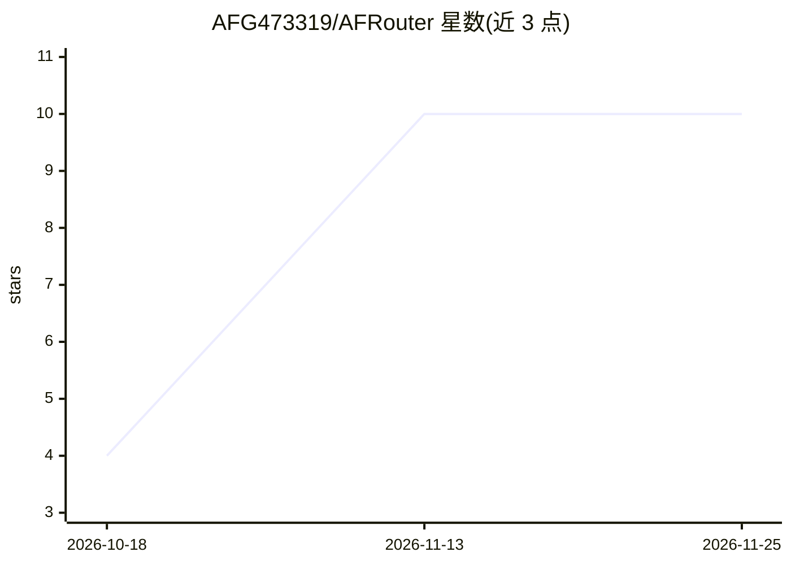

# AFG473319/AFRouter

⭐ 10 · JavaScript · MIT · 推送 2026-11-06 · [GitHub](https://github.com/AFG473319/AFRouter) · 个人维护

**自托管 AI 网关：为编程 CLI 统一路由 40+ 提供商**

自托管的 OpenAI/Anthropic 兼容网关，将 Claude Code、Codex、OpenCode、Cline、Zed 等编码 CLI 统一指向同一端点，支持 40+ 提供商、100+ 模型。机制包括按序回退链（API key/OAuth/本地提供商）、每模型能力解析（上下文窗口、思考档位、格式处理来自注册表）、配额与用量跟踪、RTK 工具输出压缩（声明节省 20-40% 输入 token），并提供原子化 CLI 配置写入。npm 全局安装，Dashboard 运行于 20128 端口，数据存于独立目录，可与上游 9Router 共存。

## 筛选速览

| 维度 | 判定 | 备注 |
|---|---|---|
| AI 角色 | `ai-ecosystem` | LLM/agent 周边工具 |
| 许可风险 | `permissive` | MIT |
| 部署形态 | `self-host` | docker 或自建部署 |
| 模型依赖 | local-ok | 支持本地模型 |
| 硬件要求 | — | 无带数字的原话,不猜 |
| 安装摩擦 | `low` | 无编译、无系统依赖或容器化 |
| 成熟度 | — | 结构信号不足 |

## 能力要点

- OpenAI/Anthropic 兼容端点聚合 40+ 提供商与 100+ 模型
- 回退链自动 failover（API key、OAuth、本地提供商）
- 配额与用量跟踪，含成本估算与重置倒计时
- RTK 工具输出压缩，声明节省 20-40% 输入 token

## 适用场景

- 把 Claude Code、Codex 等多个编码 CLI 统一接到一个端点
- 为模型配置按序回退链，配额耗尽时自动切换
- 跟踪多个订阅与 API key 账户的 token 用量与成本
- 压缩 git diff、grep 等工具输出以减少输入 token

## 场景标签

`模型网关` · 领域:Agent 开发

## 证据(README 行号)

> L3:  # AFRouter - Self-hosted AI Gateway & LLM Router
> L5: > **AFRouter** is a self-hosted, OpenAI/Anthropic-compatible AI gateway that routes coding CLIs (Claude Code, Codex,
> L41: - ✅ **Unified API** – One OpenAI/Anthropic-compatible endpoint for 40+ providers and 100+ models; switch providers 

## 星数曲线

2026-10-18 4 → 2026-11-25 10（+6）

---
*卡片 v1 · prompt 1.4 · 生成 2026-11-20 · 置信度 mid · 依据 README sha `019dba0176ef` · [字段定义](../../DATASET.md)*
