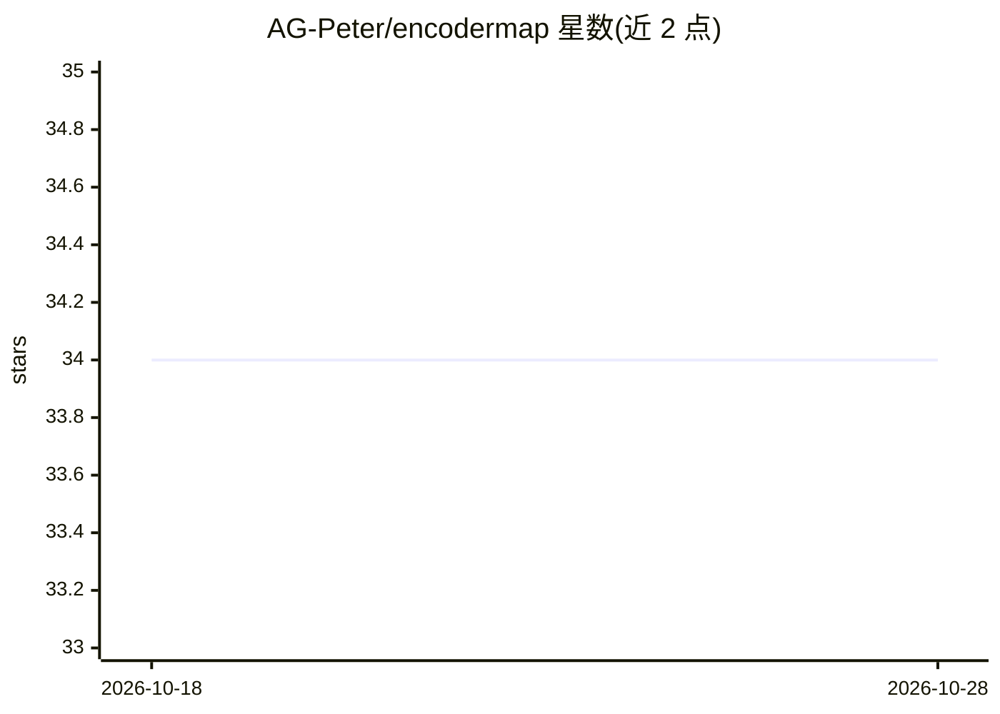

# AG-Peter/encodermap

⭐ 34 · Python · LGPL-3.0 · 推送 2026-07-06 · [GitHub](https://github.com/AG-Peter/encodermap) · [官网](https://ag-peter.github.io/encodermap/) · 组织维护

**分子构象降维与生成的 TensorFlow 库（科研用）**

基于 TensorFlow 的 Python 降维库：可将高维数据投影到低维空间（默认 2D），并支持从低维点反向生成新的高维点，主要应用于分子动力学轨迹与分子/蛋白质构象的降维与生成（提供 MD 数据可选依赖包）。要求 TensorFlow >=2.9（CPU 或 GPU 版本均可）。版本 3.0.0 目前不在 PyPI 上，需从 GitHub 源码安装；提供 mybinder 与 Google Colab 教程笔记本。由 AG-Peter 课题组（Christine Peter，康斯坦茨大学）维护，配套两篇 JCTC/JCIM 论文，并吸收了已归档的 PyEMMA 的特征化代码思路。

## 筛选速览

| 维度 | 判定 | 备注 |
|---|---|---|
| AI 角色 | `ai-native` | 本体是模型或模型工具 |
| 许可风险 | `viral` | LGPL-3.0 |
| 部署形态 | `library` | 以包/库形式分发 |
| 模型依赖 | — | README 未给出锁定关系 |
| 硬件要求 | — | 无带数字的原话,不猜 |
| 安装摩擦 | `low` | 无编译、无系统依赖或容器化 |
| 成熟度 | — | 结构信号不足 |

## 能力要点

- 高维→低维投影，且支持低维点反向生成新高维点
- 面向分子动力学数据（可选 md_requirements 安装包）
- 要求 TensorFlow >=2.9，支持 CPU/GPU 版本
- 提供 Binder/Colab 在线教程笔记本

## 适用场景

- 对分子动力学轨迹做降维可视化
- 从低维表征生成新的分子/蛋白质构象
- 通用高维数据的低维投影分析

## 场景标签

`科研工具` · 领域:学习与行业

## 证据(README 行号)

> L17: Lemke, Tobias, and Christine Peter. "EncoderMap: Dimensionality Reduction and Generation of Molecule Conformations.
> L63: This example shows how to use EncoderMap to project points from a high dimensional data set to
> L81: newly_generated_high_d_points = e_map.generate(low_d_points)

## 星数曲线

2026-10-18 34 → 2026-10-28 34（+0）

---
*卡片 v1 · prompt 1.4 · 生成 2026-10-25 · 置信度 high · 依据 README sha `cd280d11fc9b` · [字段定义](../../DATASET.md)*
