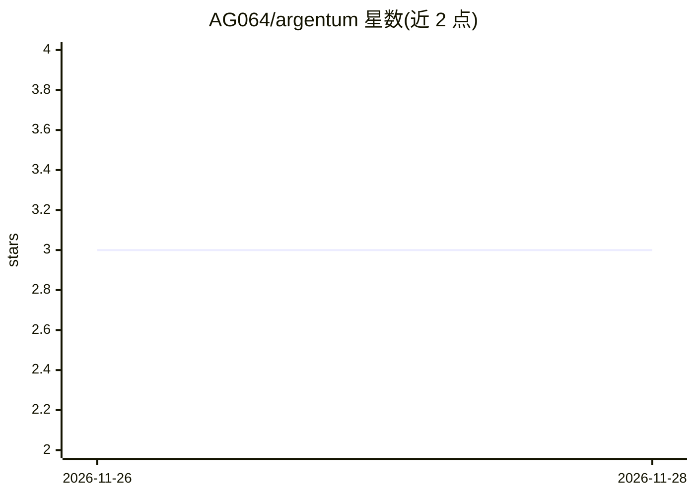

# AG064/argentum

⭐ 3 · Rust · AGPL-3.0 · 推送 2026-11-26 · [GitHub](https://github.com/AG064/argentum) · [官网](https://ag064.eu/argentum) · 个人维护

**本地优先的 Rust 原生 AI 编码 agent，覆盖桌面与手机**

Argentum 是运行在用户自己设备上的 AI 编码 agent：读取项目、编辑文件、运行命令，并依据项目保存的策略决定哪些操作需审批。同一 Rust 核心提供两个产品——Slint 原生桌面应用与 Argentum Genesis CLI（交互对话、headless JSON 任务、JSONL 服务）。除对话外的一切均为可开关模块（Git diff、目标、用量等），支持超过 40 个 provider 预设、本地模型与任意 OpenAI 兼容服务器，历史会话持久化并在崩溃后显式恢复。提供 Windows x64 与 Android arm64 的 0.1.0 预编译包，未签名会触发 SmartScreen 提示。

## 筛选速览

| 维度 | 判定 | 备注 |
|---|---|---|
| AI 角色 | `ai-native` | 本体是模型或模型工具 |
| 许可风险 | `viral` | AGPL-3.0 |
| 部署形态 | `desktop` | 安装包/桌面程序 |
| 模型依赖 | local-ok | 支持本地模型 |
| 硬件要求 | — | 无带数字的原话,不猜 |
| 安装摩擦 | `low` | 无编译、无系统依赖或容器化 |
| 成熟度 | `idea` | |

## 能力要点

- 模块化 harness：会话、Git diff、目标、用量等面板均为可选模块
- 同一核心的原生桌面（Slint）与 Android 应用，agent 在手机上本地运行
- 40+ provider 预设、本地模型及任意 OpenAI 兼容服务器
- 项目策略权限、guard 编辑校验、崩溃恢复与目标预算管理

## 适用场景

- 在自己电脑上用本地或自选模型做编码 agent 任务
- 在 Android 手机上直接运行 shell 与文件编辑类 agent 任务
- 通过 goal 命令在 token/工具/时间预算内让 agent 跨多轮完成迁移等长任务

## 场景标签

`编码 Agent` · 领域:编码与开发

## 证据(README 行号)

> L25: Argentum is an AI coding agent you run on your own machine, with the model you
> L100: - **Any model:** more than 40 provider presets, local models, and any

## 星数曲线

2026-11-26 3 → 2026-11-28 3（+0）

---
*卡片 v1 · prompt 1.4 · 生成 2026-11-26 · 置信度 high · 依据 README sha `da51d9143178` · [字段定义](../../DATASET.md)*
