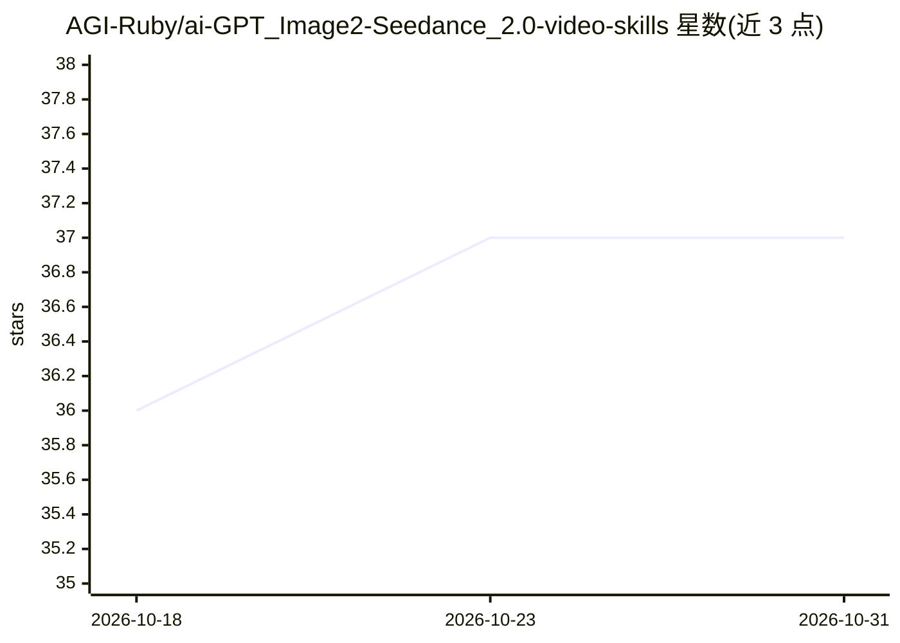

# AGI-Ruby/ai-GPT_Image2-Seedance_2.0-video-skills

⭐ 37 · JavaScript · NOASSERTION · 推送 2026-05-18 · [GitHub](https://github.com/AGI-Ruby/ai-GPT_Image2-Seedance_2.0-video-skills) · 个人维护

**面向 Codex/Claude Code 的视频提示词技能包（2 个 SKILL）**

打包两个可复用的 Codex 技能：storyboard-to-seedance-video 将创意转为 GPT Image 2 分镜提示词再到 Seedance 2.0 视频提示词的两阶段流水线，附带模板、填写指南与 X/Twitter 宣发帖生成；romantic-ink-cinema-previs 将情感运动创意转为镜头编排、身体节奏、空间张力等结构化电影预演输出。仓库本身不调用视频生成 API，仅产出提示词与创作工作流。通过 npx 安装到 Codex 或 Claude Code，也可手动复制技能目录。

## 筛选速览

| 维度 | 判定 | 备注 |
|---|---|---|
| AI 角色 | `ai-ecosystem` | LLM/agent 周边工具 |
| 许可风险 | `none` | NOASSERTION |
| 部署形态 | `library` | 以包/库形式分发 |
| 模型依赖 | — | README 未给出锁定关系 |
| 硬件要求 | — | 无带数字的原话,不猜 |
| 安装摩擦 | `low` | 无编译、无系统依赖或容器化 |
| 成熟度 | — | 结构信号不足 |

## 能力要点

- 两阶段分镜→视频提示词流水线（GPT Image 2 + Seedance 2.0）
- 情感运动转结构化电影预演（镜头编排/节奏/空间张力）
- 附带提示词模板、填写指南与 X/Twitter 宣发帖格式
- npx 安装/升级/卸载/doctor 命令，支持 Codex 与 Claude Code

## 适用场景

- 把角色图和动作概念转为可复用的分镜与视频提示词
- 生成情感化短片的逐拍电影预演结构
- 需要可重复使用的图片参考+分镜+视频提示词工作流的创作者

## 场景标签

`提示工程` · 领域:Agent 开发

## 证据(README 行号)

> L3: Reusable Codex skills for storyboard-driven video prompting, Seedance workflows, and cinematic previs.
> L201: - This repo does not execute video generation APIs by itself.
> L98: npx agi-ruby-ai-video-skills install --target codex

## 星数曲线

2026-10-18 36 → 2026-10-31 37（+1）

---
*卡片 v1 · prompt 1.4 · 生成 2026-10-25 · 置信度 high · 依据 README sha `7924a505011d` · [字段定义](../../DATASET.md)*
