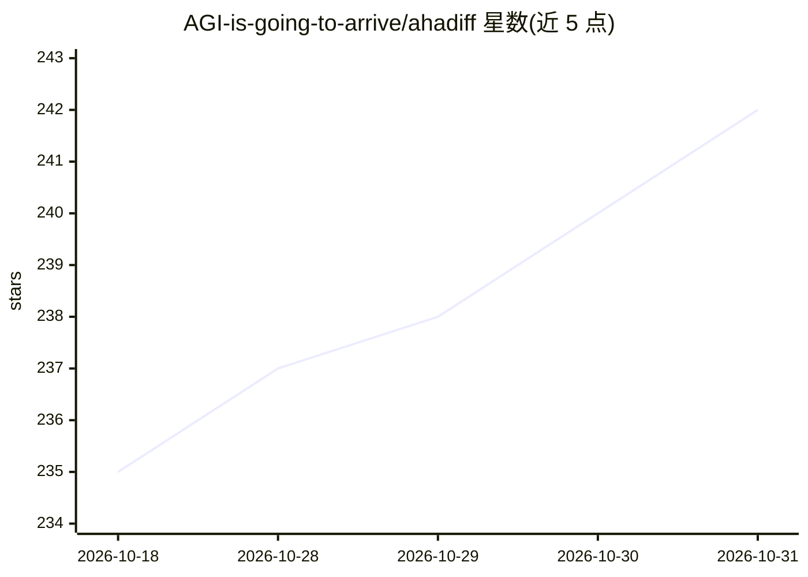

# AGI-is-going-to-arrive/ahadiff

⭐ 242 · Python · MIT · 推送 2026-09-08 · [GitHub](https://github.com/AGI-is-going-to-arrive/ahadiff) · [官网](https://agi-is-going-to-arrive.github.io/ahadiff/) · 个人维护 · 中文 README

**把 Git/diff/文档改动变成带证据的课程与测验的学习工具**

面向开发者的本地优先学习工具：读取 Git 改动、两个文件版本、粘贴的 diff、快照或单个 Markdown 文档，调用本地或远程 LLM 生成带来源证据的讲解（每条声明标注 verified/weak/not proven 等状态）、测验题与间隔复习卡片（FSRS 排程，可导出 Anki .apkg）。课程与复习历史保存在工作目录的 .ahadiff/ 下，隐私模式默认 strict_local，可接 Ollama/LM Studio 本地模型。以 pipx/uv 安装 CLI 加 WebUI，需 Python 3.11+ 与指定 SQLite 版本；不支持 PDF 与网页抓取。

## 筛选速览

| 维度 | 判定 | 备注 |
|---|---|---|
| AI 角色 | `ai-native` | 本体是模型或模型工具 |
| 许可风险 | `permissive` | MIT |
| 部署形态 | `library` | 以包/库形式分发 |
| 模型依赖 | local-ok | 支持本地模型 |
| 硬件要求 | — | 无带数字的原话,不猜 |
| 安装摩擦 | `low` | 无编译、无系统依赖或容器化 |
| 成熟度 | — | 结构信号不足 |

## 能力要点

- 五种输入来源：Git 改动/两文件/粘贴 diff/快照/Markdown 文档
- 每个声明可追溯到源码位置并标注证据状态（verified/weak/contradicted 等）
- FSRS 间隔复习排程，复习卡可导出 Anki .apkg，可选 torch 做 FSRS 参数优化
- 可为 codex/claude/cursor/copilot 等编码工具写入项目引导文件，并提供只读 MCP 服务器

## 适用场景

- 从自己或同事的代码改动、AI 生成 diff 中学习并复习
- 把 code review 的补丁转成带证据的讲解与测验
- 本地模型（Ollama/LM Studio）下离线生成课程保护代码隐私

## 场景标签

`教程课程` · 领域:学习与行业

## 证据(README 行号)

> L9: AhaDiff keeps your lessons and review history in your working folder. You can study your own fixes, a colleague's ed
> L58: 3. Preview the source. You can add **Review notes** or enable **More options for this source → Active transfer prac
> L118: - **Lesson and evidence:** choose Hint, Compact, or Full explanations. Inspect each claim's source and evidence st

## 星数曲线

2026-10-18 235 → 2026-10-31 242（+7）

---
*卡片 v1 · prompt 1.4 · 生成 2026-10-22 · 置信度 high · 依据 README sha `ecdc81721d33` · [字段定义](../../DATASET.md)*
