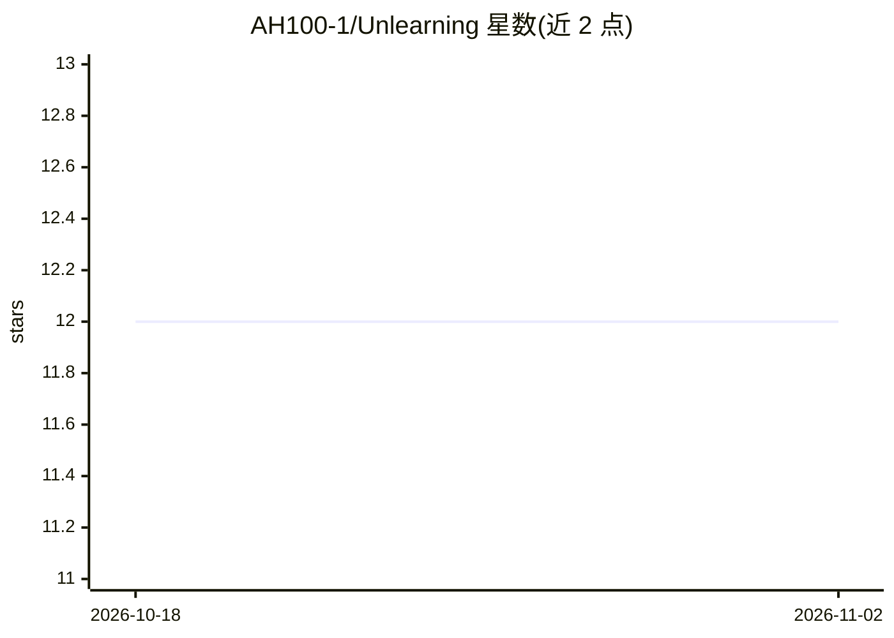

# AH100-1/Unlearning

⭐ 12 · Jupyter Notebook · 推送 2025-12-02 · [GitHub](https://github.com/AH100-1/Unlearning) · 个人维护

**Bad-Teacher 蒸馏的机器遗忘与模型压缩实验代码（ResNet-18/CIFAR-10）**

研究性代码仓库：在教师-学生知识蒸馏框架下实现机器遗忘（从已训练模型中移除 forget set 子集的影响），并用“坏教师”在遗忘集上故意误导学生；同时提出压缩与遗忘统一在单一蒸馏阶段完成的流程，从好/坏两个教师同时蒸馏学生（如 ResNet-50→ResNet-18）。以 CIFAR-10、ResNet-18 学生模型为主做实验，分析温度 τ 对遗忘效果的影响（实验显示无单调关系）以及遗忘精度与测试精度的权衡。提供 shell/python 脚本形式的训练流程与实验日志，面向机器遗忘方向的科研人员复现实验。

## 筛选速览

| 维度 | 判定 | 备注 |
|---|---|---|
| AI 角色 | `ai-native` | 本体是模型或模型工具 |
| 许可风险 | `none` | — |
| 部署形态 | `None` |  |
| 模型依赖 | — | README 未给出锁定关系 |
| 硬件要求 | — | 无带数字的原话,不猜 |
| 安装摩擦 | `low` | 无编译、无系统依赖或容器化 |
| 成熟度 | — | 结构信号不足 |

## 能力要点

- 坏教师蒸馏实现机器遗忘（好教师保留、坏教师误导 forget set）
- 压缩与遗忘统一的单阶段蒸馏流程
- 温度 τ 对遗忘影响的实验分析（ResNet-18 上无单调关系）
- 提供 .sh 实用脚本与可复现实验日志

## 适用场景

- 复现 bad-teacher 蒸馏的机器遗忘实验
- 研究压缩与遗忘同时进行时的精度权衡
- 分析温度参数对遗忘效果的影响

## 场景标签

 · 领域:深度学习研究/机器遗忘

## 证据(README 行号)

> L3: This repository investigates machine unlearning using a bad teacher–student distillation framework, with a particula
> L15: We mainly evaluate ResNet-18 as the student model on CIFAR-10

## 星数曲线

2026-10-18 12 → 2026-11-02 12（+0）

---
*卡片 v1 · prompt 1.4 · 生成 2026-11-01 · 置信度 high · 依据 README sha `14f6627aec83` · [字段定义](../../DATASET.md)*
