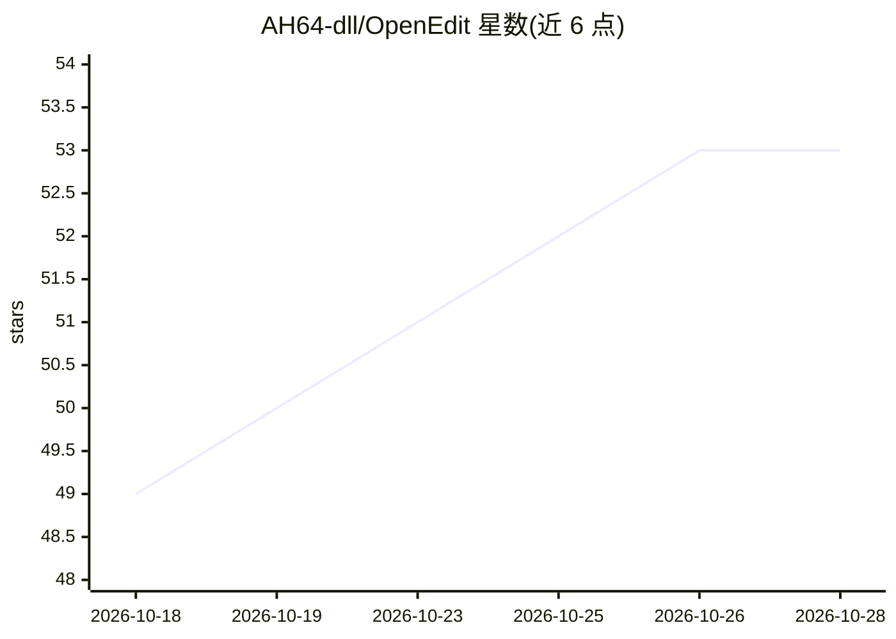

# AH64-dll/OpenEdit

⭐ 53 · Python · MIT · 推送 2026-10-17 · [GitHub](https://github.com/AH64-dll/OpenEdit) · [官网](https://ah64-dll.github.io/OpenEdit/) · 个人维护

**AI 原生本地视频编辑器，通过 MCP 供 agent 驱动剪辑**

桌面视频编辑器，自带预览、时间线、图形与导出，并以本地 MCP 服务器形式向外部 AI agent 暴露 query_project、edit_project、run_script、trigger_render 等接口：用户选中片段并描述修改，agent 调用接口完成剪辑，编辑可逆且重开不丢失。渲染走 FFmpeg/MLT，内置 CPU 渲染器，可选硬件编码器。可选内置聊天 agent 与本地 Whisper 转录。安装器创建私有 Python 环境、下载固定版本 Node 与 FFmpeg/MLT 运行时并自检完整工作流；Windows/Linux 提供 ZIP 发布包，外部 agent 无需在 OpenEdit 内配置模型 key。

## 筛选速览

| 维度 | 判定 | 备注 |
|---|---|---|
| AI 角色 | `ai-native` | 本体是模型或模型工具 |
| 许可风险 | `permissive` | MIT |
| 部署形态 | `desktop` | 安装包/桌面程序 |
| 模型依赖 | — | README 未给出锁定关系 |
| 硬件要求 | — | 无带数字的原话,不猜 |
| 安装摩擦 | `medium` | 含编译或系统依赖之一 |
| 成熟度 | — | 结构信号不足 |

## 能力要点

- 本地 MCP 服务器暴露 6 个编辑/渲染接口供外部 agent 调用
- 可选本地 Whisper 转录（--whisper）
- 安装器自建私有 Python 环境并测试完整编辑-预览-导出-重开工作流
- agent 仅读取有界时间戳帧与转录区间，避免重复读入整个视频

## 适用场景

- 让 Claude/Codex/OpenCode 类 agent 按自然语言指令剪辑视频片段
- 通过转录区间做基于对话内容的选取与编辑
- 本地优先、无需云端模型 key 的视频粗剪与导出

## 场景标签

`图像视频处理` · 领域:感知与多模态

## 证据(README 行号)

> L3: An AI-native video editor: **select the moment, describe the edit, review the result**.
> L92: MCP server and streams actual tool results. Local transcription is optional
> L31: The installer creates a private Python environment, verifies pinned Node and

## 星数曲线

2026-10-18 49 → 2026-10-28 53（+4）

---
*卡片 v1 · prompt 1.4 · 生成 2026-10-24 · 置信度 high · 依据 README sha `078304618b29` · [字段定义](../../DATASET.md)*
