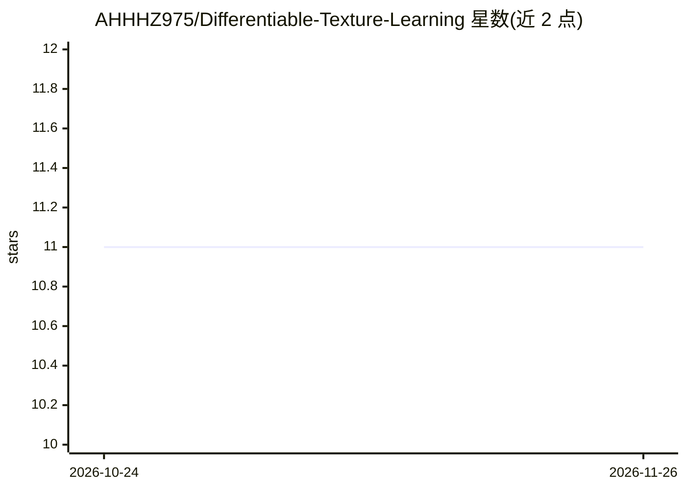

# AHHHZ975/Differentiable-Texture-Learning

⭐ 11 · Python · 推送 2025-12-07 · [GitHub](https://github.com/AHHHZ975/Differentiable-Texture-Learning) · [官网](https://ahhhz975.github.io/DifferentiableTextureLearning/) · 组织维护

**3D纹理生成微调研究代码：用可微奖励端到端优化**

WACV 2026 论文 'End-to-End Fine-Tuning of 3D Texture Generation using Differentiable Rewards' 的官方实现。提出端到端可微、免强化学习的框架，将人类反馈表达为可微奖励函数并嵌入 3D 纹理合成管线，通过几何与外观模块反向传播偏好信号，并引入三个几何感知奖励函数。README 提供 conda 环境搭建、依赖安装、训练与推理命令，以及 Windows 下 nvdiffrast/D3PO 的常见问题排查说明。

## 筛选速览

| 维度 | 判定 | 备注 |
|---|---|---|
| AI 角色 | `ai-native` | 本体是模型或模型工具 |
| 许可风险 | `none` | — |
| 部署形态 | `library` | 以包/库形式分发 |
| 模型依赖 | — | README 未给出锁定关系 |
| 硬件要求 | — | 无带数字的原话,不猜 |
| 安装摩擦 | `high` | 编译与系统依赖俱全 |
| 成熟度 | — | 结构信号不足 |

## 能力要点

- 端到端可微、免强化学习的 3D 纹理微调框架
- 三个几何感知奖励函数（几何与外观模块联合反向传播）
- 提供训练与推理脚本（CUDA_VISIBLE_DEVICES 指定单卡）
- 含 Windows nvdiffrast、diffusers 版本兼容等问题排查指南

## 适用场景

- 复现论文中 3D 纹理生成微调的实验结果
- 基于文本提示生成符合几何结构的 3D 网格纹理
- 研究可微奖励函数用于生成模型偏好对齐

## 场景标签

`图像生成` `微调` · 领域:内容生成

## 证据(README 行号)

> L2: # End-to-End Fine-Tuning of 3D Texture Generation using Differentiable Rewards
> L8: While recent 3D generative models can produce high-quality texture images, they often fail to capture human preferen

## 星数曲线

2026-10-24 11 → 2026-11-26 11（+0）

---
*卡片 v1 · prompt 1.4 · 生成 2026-11-19 · 置信度 high · 依据 README sha `df7e47fee954` · [字段定义](../../DATASET.md)*
