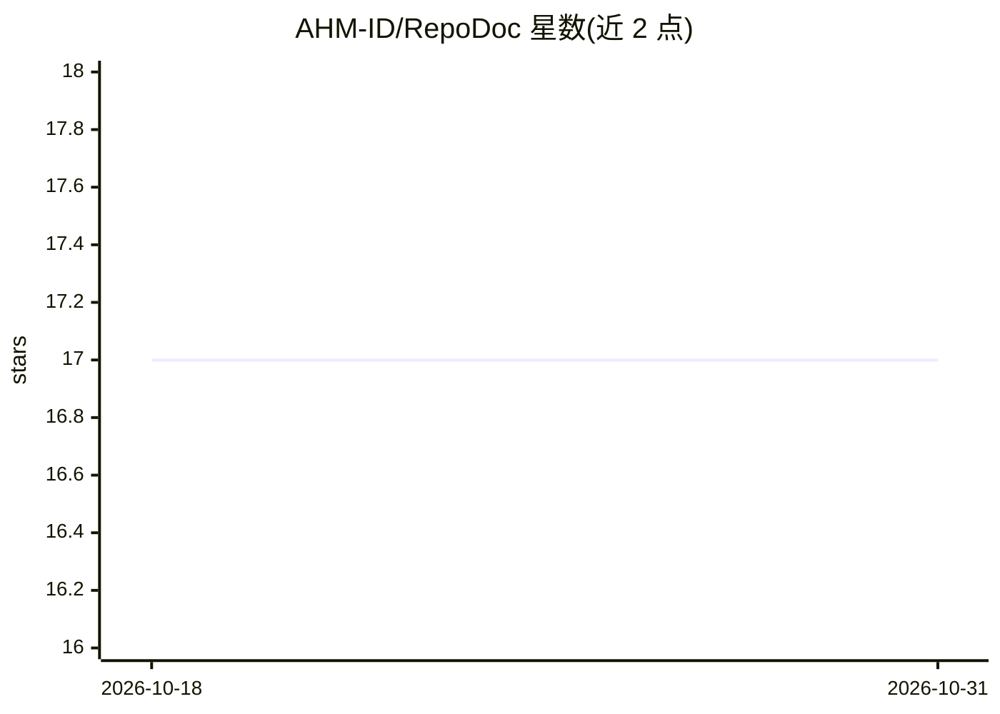

# AHM-ID/RepoDoc

⭐ 17 · HTML · MIT · 推送 2026-08-13 · [GitHub](https://github.com/AHM-ID/RepoDoc) · [官网](https://ahm-id.github.io/RepoDoc) · 个人维护

**零依赖脚本：把整个代码仓库导出为单个 Markdown 文档**

由 Bash（Linux/macOS）与 PowerShell（Windows）脚本组成的命令行工具：扫描项目目录，生成目录树并提取文本源码文件，输出单个 code-doc.md 文档，用于项目文档、代码审查、归档或交给 AI 助手分析。零第三方依赖，仅在 Git 可用时自动遵循 .gitignore；默认过滤二进制、Markdown、CSV 与超限大文件，支持自定义排除目录与文件大小上限。安装仅需 git clone 并 chmod 加执行权限。

## 筛选速览

| 维度 | 判定 | 备注 |
|---|---|---|
| AI 角色 | `ai-ecosystem` | LLM/agent 周边工具 |
| 许可风险 | `permissive` | MIT |
| 部署形态 | `None` |  |
| 模型依赖 | — | README 未给出锁定关系 |
| 硬件要求 | — | 无带数字的原话,不猜 |
| 安装摩擦 | `low` | 无编译、无系统依赖或容器化 |
| 成熟度 | — | 结构信号不足 |

## 能力要点

- Bash 与 PowerShell 双平台脚本，零外部依赖
- 生成含目录树与源码的单个 Markdown 文档
- 可选遵循 .gitignore，过滤二进制/Markdown/CSV/超大文件
- 支持自定义排除目录与文件大小上限（KB）

## 适用场景

- 把整个代码库打包成单个文档交给 AI 助手做分析或代码审查
- 生成项目文档或长期归档
- 仓库迁移或重构前导出完整代码快照

## 场景标签

 · 领域:开发者工具/LLM 上下文准备

## 证据(README 行号)

> L3: > Export any source code repository into a single AI-ready Markdown document.
> L24: Large Language Models (LLMs) perform significantly better when they receive complete project context.
> L171: 3. Share the generated document with your AI assistant.

## 星数曲线

2026-10-18 17 → 2026-10-31 17（+0）

---
*卡片 v1 · prompt 1.4 · 生成 2026-10-30 · 置信度 high · 依据 README sha `032971326bd7` · [字段定义](../../DATASET.md)*
