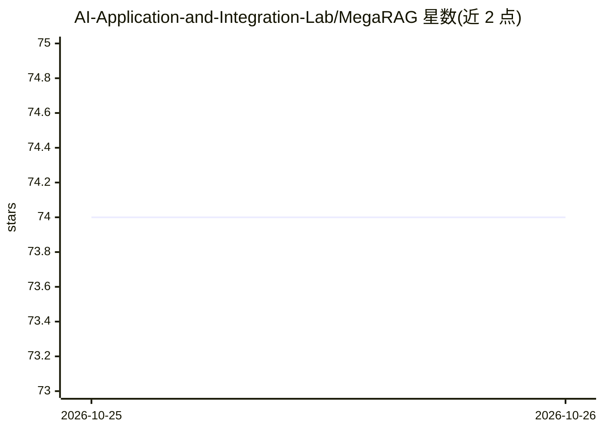

# AI-Application-and-Integration-Lab/MegaRAG

⭐ 74 · Python · NOASSERTION · 推送 2026-04-17 · [GitHub](https://github.com/AI-Application-and-Integration-Lab/MegaRAG) · 组织维护

**构建多模态知识图谱并实现文档全局视觉问答的 RAG 系统**

ACL 2026 论文的配套实现：将 PDF 文档解析后构建多模态知识图谱（MMKG），结合基于图的推理与页面检索技术，对文档进行全局视觉问答。依赖 MinerU 做文档解析，需 Python 3.9+、GPU 做 embedding 推理与 OpenAI API key。以 git clone 源码方式安装，提供 tiny 示例（含示例 PDF 与查询文件）与自定义数据集模板（egs/.template，经 conf/addon_params.yaml 配置实体类型），通过脚本完成建图与查询。项目采用自定义许可证，学术或商业使用需联系作者。

## 筛选速览

| 维度 | 判定 | 备注 |
|---|---|---|
| AI 角色 | `ai-native` | 本体是模型或模型工具 |
| 许可风险 | `none` | NOASSERTION |
| 部署形态 | `None` |  |
| 模型依赖 | — | README 未给出锁定关系 |
| 硬件要求 | — | 无带数字的原话,不猜 |
| 安装摩擦 | `low` | 无编译、无系统依赖或容器化 |
| 成熟度 | — | 结构信号不足 |

## 能力要点

- 从 PDF 构建多模态知识图谱（MMKG）
- 图推理与页面检索结合的全局视觉问答
- 提供 tiny 示例工程与自定义数据集模板（egs/.template）
- 自定义许可证，学术/商业使用需联系作者

## 适用场景

- 对长篇 PDF 文档做跨页面的全局视觉问答
- 在自己的 PDF 数据集上构建多模态知识图谱并检索问答
- 复现或扩展 ACL 2026 论文方法

## 场景标签

`RAG` `知识图谱` `多模态` `文档问答` · 领域:知识与检索

## 证据(README 行号)

> L6: **MegaRAG** enables **global visual question answering** on documents by constructing a **Multimodal Knowledge Graph
> L8: > This work has been accepted to **ACL 2026**.

## 星数曲线

2026-10-25 74 → 2026-10-26 74（+0）

---
*卡片 v1 · prompt 1.4 · 生成 2026-10-24 · 置信度 high · 依据 README sha `e1f11663ab64` · [字段定义](../../DATASET.md)*
