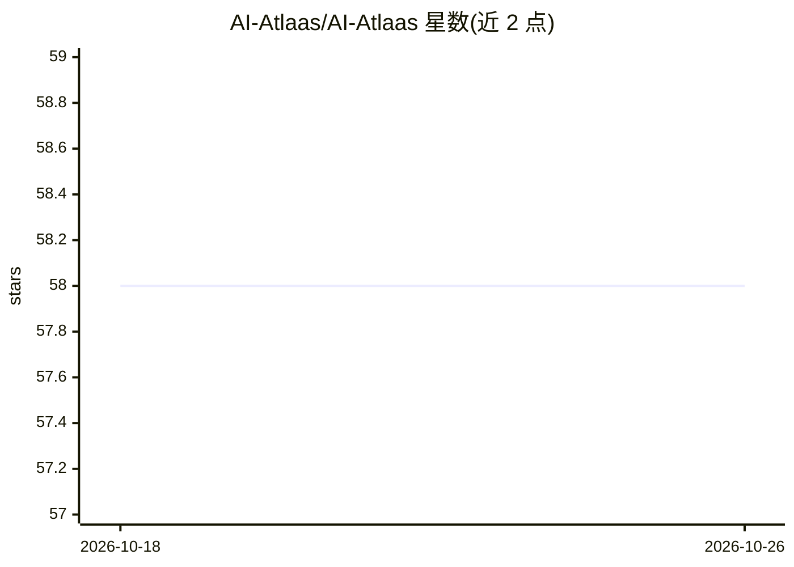

# AI-Atlaas/AI-Atlaas

⭐ 58 · GPL-3.0 · 推送 2026-07-18 · [GitHub](https://github.com/AI-Atlaas/AI-Atlaas) · [官网](https://ai-atlas.mosn.me/) · 个人维护

**网络 AI 工具名录：按类别收录免费与付费 AI 工具**

一个以 Markdown 清单形式维护的 AI 工具目录，收录互联网上的免费与付费工具，按聊天助手、生产力、文字转语音、音频生成、设计与创意（含图像生成、UI/UX、视频多媒体）等类别组织。每条目给出工具名称与一句介绍，条目混合闭源商业产品（如 ChatGPT、Midjourney）与开源项目（如 ChatTTS、Sherpa Onnx）。本体不含可安装或运行的代码，仅提供浏览与检索信息。

## 筛选速览

| 维度 | 判定 | 备注 |
|---|---|---|
| AI 角色 | `ai-knowledge` | 知识聚合/清单类 |
| 许可风险 | `viral` | GPL-3.0 |
| 部署形态 | `None` |  |
| 模型依赖 | — | README 未给出锁定关系 |
| 硬件要求 | — | 无带数字的原话,不猜 |
| 安装摩擦 | `medium` | 含编译或系统依赖之一 |
| 成熟度 | — | 结构信号不足 |

## 能力要点

- 按多级类别组织的 AI 工具清单（聊天/生产力/语音/设计等）
- 同时收录免费与付费工具
- 条目附一句话简介，混合闭源产品与开源项目

## 适用场景

- 按类别浏览和发现可用的 AI 工具
- 查找特定场景（TTS、图像生成、UI 设计）下的候选工具
- 了解当前网络 AI 工具的大致覆盖范围

## 场景标签

`精选清单` · 领域:学习与行业

## 证据(README 行号)

> L4: This is an atlas of AI tools that are available on the web. This directory contains both free and paid tools.
> L10: ## List of Tools

## 星数曲线

2026-10-18 58 → 2026-10-26 58（+0）

---
*卡片 v1 · prompt 1.4 · 生成 2026-10-24 · 置信度 high · 依据 README sha `3d51ec65af4c` · [字段定义](../../DATASET.md)*
