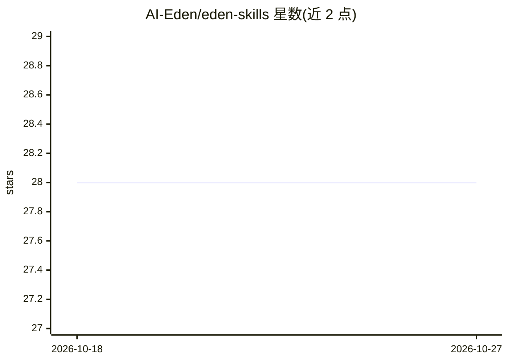

# AI-Eden/eden-skills

⭐ 28 · Rust · MIT · 推送 2026-04-15 · [GitHub](https://github.com/AI-Eden/eden-skills) · 组织维护

**AI agent 技能管理 CLI：确定性安装与自愈修复**

Rust 编写的单二进制技能管理器，面向使用 Claude Code、Cursor、Codex 等 AI 编程代理的开发者。通过 skills.toml 声明配置，以 skills.lock 按提交 SHA 锁定已装技能，apply 命令可在任意机器复现相同状态；doctor 检测断链、漂移与风险项，repair 自动修复；支持 40+ 种代理的自动检测，并可通过 --target docker:<container> 向运行中容器安装技能。无运行时依赖，仅需 git。README 声明处于活跃开发期，Phase 3（爬虫/分类/策展）为计划项，且提示不适用于不容忍破坏性变更的生产场景。

## 筛选速览

| 维度 | 判定 | 备注 |
|---|---|---|
| AI 角色 | `ai-ecosystem` | LLM/agent 周边工具 |
| 许可风险 | `permissive` | MIT |
| 部署形态 | `library` | 以包/库形式分发 |
| 模型依赖 | — | README 未给出锁定关系 |
| 硬件要求 | — | 无带数字的原话,不猜 |
| 安装摩擦 | `low` | 无编译、无系统依赖或容器化 |
| 成熟度 | `idea` | |

## 能力要点

- skills.lock 按提交 SHA 锁定，apply 跨机器复现一致状态
- doctor/repair 检测并自愈断链、漂移与风险项
- 自动检测 40+ 种 agent 并链接技能，支持 docker 与自定义路径目标
- 单约 10MB 二进制，零运行时依赖，仅需 git

## 适用场景

- 在 Claude Code、Cursor 等多个代理间统一安装和管理技能
- 团队用版本化的 skills.toml 共享技能配置并随处复现
- 向运行中的 Docker 容器内安装 agent 技能

## 场景标签

 · 领域:AI agent 工具链/开发基础设施

## 证据(README 行号)

> L9: Deterministic, self-healing skills manager for AI agents. Single binary. Zero runtime dependencies.
> L59: Auto-detects installed agents (Claude Code, Cursor, Codex, Windsurf, etc.) and links the skill to each. When multip
> L101: 40+ agents including Claude Code, Cursor, Codex, Windsurf, Gemini CLI, GitHub Copilot, Cline, Roo, Continue, and m

## 星数曲线

2026-10-18 28 → 2026-10-27 28（+0）

---
*卡片 v1 · prompt 1.4 · 生成 2026-10-26 · 置信度 high · 依据 README sha `0014def845ba` · [字段定义](../../DATASET.md)*
