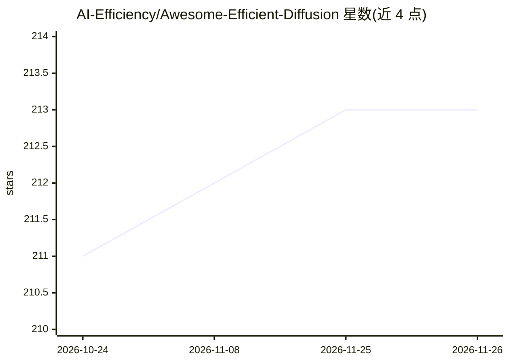

# AI-Efficiency/Awesome-Efficient-Diffusion

⭐ 213 · 推送 2026-11-16 · [GitHub](https://github.com/AI-Efficiency/Awesome-Efficient-Diffusion) · 个人维护

**面向研究者的高效扩散模型论文与代码精选清单**

按年份组织的论文与代码集合，主题覆盖图像、视频、3D 生成、世界模型与扩散语言模型的加速方法，包括快速采样、蒸馏、特征与 KV 缓存、并行解码、高效注意力、量化、剪枝、模型压缩、训练与部署。清单附带基准测试（GenEval、VBench）与综述论文栏目，由 Haotong Qin 发起并接受社区贡献。仅收录文献与代码链接，不含可安装运行的软件本体。

## 筛选速览

| 维度 | 判定 | 备注 |
|---|---|---|
| AI 角色 | `ai-knowledge` | 知识聚合/清单类 |
| 许可风险 | `none` | — |
| 部署形态 | `None` |  |
| 模型依赖 | — | README 未给出锁定关系 |
| 硬件要求 | — | 无带数字的原话,不猜 |
| 安装摩擦 | `low` | 无编译、无系统依赖或容器化 |
| 成熟度 | — | 结构信号不足 |

## 能力要点

- 按年份（2022–2026）组织的高效扩散与流匹配论文清单
- 覆盖量化、蒸馏、缓存、稀疏注意力、并行解码等加速主题
- 收录扩散语言模型与视频扩散方向的专门条目
- 附基准套件（GenEval、VBench）与综述论文栏目

## 适用场景

- 查找扩散模型加速/量化/蒸馏方向的论文与开源实现
- 调研扩散语言模型的推理效率研究进展
- 为视频或图像生成模型选型时查阅相关基准与综述

## 场景标签

`精选清单` · 领域:学习与行业

## 证据(README 行号)

> L3: A collection of papers and code on efficient diffusion and flow matching models for image, video, and 3D generation,
> L27: ## Papers by Year

## 星数曲线

2026-10-24 211 → 2026-11-26 213（+2）

---
*卡片 v1 · prompt 1.4 · 生成 2026-11-25 · 置信度 high · 依据 README sha `929b87574e5c` · [字段定义](../../DATASET.md)*
