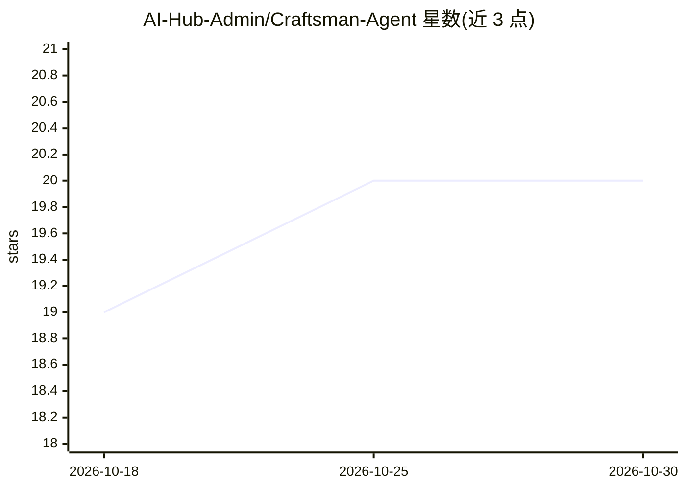

# AI-Hub-Admin/Craftsman-Agent

⭐ 20 · Python · 推送 2026-10-03 · [GitHub](https://github.com/AI-Hub-Admin/Craftsman-Agent) · [官网](https://craftsman-agent.aiagenta2z.com/) · 组织维护 · 中文 README

**创意设计 Agent 平台：把想法生成为 3D 模型、拼装图纸与实体产品**

Craftsman Agent 是一个创意设计 Agent 应用与商店：通过 20+ 个 Agent 技能，从文字提示与参考图生成乐高/Minecraft 分步搭建图、3D 模型（Tripo/Meshy 等 API 经 OneKey Agent Gateway 调用）、特斯拉车衣、拼豆图案、海报、社交媒体帖子及珠宝/服装/鞋包设计等；并连接 1000+ 工匠与工坊的按需制造（MOD/POD）平台，可将数字资产一键转为实体成品。提供在线 Studio、Gallery 与 Marketplace，技能支持 API/Skills/CLI/MCP 方式调用。

## 筛选速览

| 维度 | 判定 | 备注 |
|---|---|---|
| AI 角色 | `ai-native` | 本体是模型或模型工具 |
| 许可风险 | `none` | — |
| 部署形态 | `library` | 以包/库形式分发 |
| 模型依赖 | — | README 未给出锁定关系 |
| 硬件要求 | — | 无带数字的原话,不猜 |
| 安装摩擦 | `low` | 无编译、无系统依赖或容器化 |
| 成熟度 | — | 结构信号不足 |

## 能力要点

- 20+ 设计类 Agent 技能（图像/3D/乐高/Minecraft/车衣/拼豆等）
- 3D 生成经 OneKey Agent Gateway 调用 Tripo/Meshy 等 API
- 数字资产可经 MOD/POD 平台转为实体产品
- 技能支持 API、Skills、CLI、MCP 四种调用方式

## 适用场景

- 把一句话创意变成乐高或 Minecraft 分步搭建图纸
- 生成可下单制造的定制珠宝、服装、鞋包设计
- 批量制作小红书、Instagram、X 的 AI 帖子与知识卡片
- 将 AI 生成的数字资产发布到 Gallery 或 Marketplace 展示售卖

## 场景标签

`图像生成` · 领域:内容生成

## 证据(README 行号)

> L6: Craftsman Craftsman Agent helps turn your ideas into digital assets and agentic manufacture on demand platform help 
> L17: |3d-generator|AI Generated 3D Models using SOTA APIs such as Tripo/Meshy/TripoSR/etc served on OneKey Agent Gateway
> L104: |generate_lego_build_plan|API, Skills, CLI, MCP|Call Craftsman Agent API OneKey Router to generate a LEGO 3D step-

## 星数曲线

2026-10-18 19 → 2026-10-30 20（+1）

---
*卡片 v1 · prompt 1.4 · 生成 2026-10-28 · 置信度 high · 依据 README sha `2b8f2633c1d3` · [字段定义](../../DATASET.md)*
