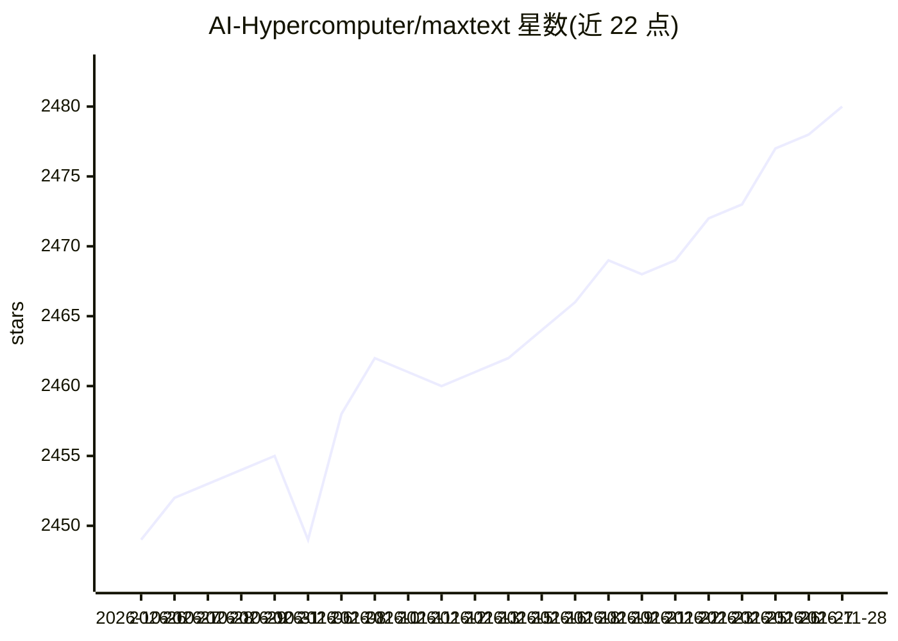

# AI-Hypercomputer/maxtext

⭐ 2,480 · Python · Apache-2.0 · 推送 2026-11-27 · [GitHub](https://github.com/AI-Hypercomputer/maxtext) · [官网](https://maxtext.readthedocs.io) · 组织维护

**基于 JAX 的开源 LLM 训练库：面向 TPU/GPU 集群做预训练与后训练**

纯 Python/JAX 编写的开源 LLM 库与参考实现，面向 Google Cloud TPU 与 GPU 的训练场景。提供 Gemma、Llama、DeepSeek、Qwen、Mistral 等模型库，支持最多数万芯片规模的预训练，以及 SFT、GRPO、GSPO 等后训练技术；RL 采样借助 vLLM，checkpoint 用 Orbax，优化用 Optax，数据加载用 Grain。通过 PyPI 安装或预构建容器镜像运行，推荐 Python 3.12，README 声明 main 分支未必达到生产可用状态。

## 筛选速览

| 维度 | 判定 | 备注 |
|---|---|---|
| AI 角色 | `ai-ecosystem` | LLM/agent 周边工具 |
| 许可风险 | `permissive` | Apache-2.0 |
| 部署形态 | `library` | 以包/库形式分发 |
| 模型依赖 | local-ok | 支持本地模型 |
| 硬件要求 | — | 无带数字的原话,不猜 |
| 安装摩擦 | `low` | 无编译、无系统依赖或容器化 |
| 成熟度 | — | 结构信号不足 |

## 能力要点

- 支持单主机到超大规模集群的预训练（宣称达数万芯片规模）
- 后训练覆盖 SFT、GRPO、GSPO，多主机 RL 教程可用
- 模型库含 Gemma/Llama/DeepSeek/Qwen/Kimi/GLM/Mistral/GPT-OSS 等多家模型
- 提供 agent skills 库供 AI 编码助手遵循的可复用工作流

## 适用场景

- 从零开始预训练自己的大模型，在 TPU/GPU 上做实验
- 对开源或专有模型做 SFT 或强化学习后训练
- 训练后用 vLLM 部署服务的参考实现

## 场景标签

`模型训练` `微调` `强化学习` · 领域:训练与推理

## 证据(README 行号)

> L9: MaxText is a high performance, highly scalable, open-source LLM library and reference implementation written in pure
> L11: MaxText provides a library of high performance models to choose from, including Gemma, Llama, DeepSeek, Qwen, and M
> L90: MaxText leverages JAX AI libraries and presents a cohesive and comprehensive demonstration of training at scale by 

## 星数曲线

2026-10-26 2,449 → 2026-11-28 2,480（+31）

---
*卡片 v1 · prompt 1.4 · 生成 2026-11-28 · 置信度 high · 依据 README sha `b3a7598d5276` · [字段定义](../../DATASET.md)*
