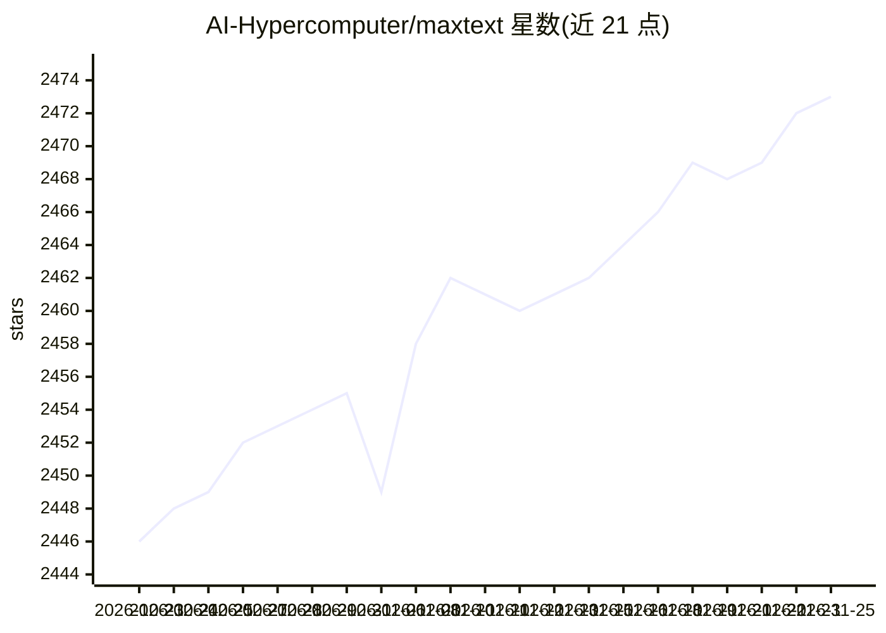

# AI-Hypercomputer/maxtext

⭐ 2,473 · Python · Apache-2.0 · 推送 2026-11-24 · [GitHub](https://github.com/AI-Hypercomputer/maxtext) · [官网](https://maxtext.readthedocs.io) · 组织维护

**基于 JAX 的 LLM 训练库：供研究者在 TPU/GPU 上预训练与后训练大模型**

纯 Python/JAX 编写的开源 LLM 训练库与参考实现，面向 Google Cloud TPU 与 GPU，支持 Gemma、Llama、DeepSeek、Qwen、Mistral 等模型家族的预训练（可扩至数万芯片）与后训练（SFT、GRPO、GSPO）。依赖 JAX 与 XLA 编译器，配合 Flax、Tunix、Orbax、Optax、Grain 等 JAX 生态库构成完整训练栈；也支持多模态 VLM 训练、DiLoCo 跨切片分布式训练，并可经 vLLM 部署。通过 PyPI 安装，提供预构建容器镜像，推荐 Python 3.12。

## 筛选速览

| 维度 | 判定 | 备注 |
|---|---|---|
| AI 角色 | `ai-ecosystem` | LLM/agent 周边工具 |
| 许可风险 | `permissive` | Apache-2.0 |
| 部署形态 | `library` | 以包/库形式分发 |
| 模型依赖 | local-ok | 支持本地模型 |
| 硬件要求 | — | 无带数字的原话,不猜 |
| 安装摩擦 | `low` | 无编译、无系统依赖或容器化 |
| 成熟度 | — | 结构信号不足 |

## 能力要点

- 提供 Gemma/Llama/DeepSeek/Qwen/Mistral 等多家族模型的 JAX 参考实现
- 支持预训练与 SFT/GRPO/GSPO 后训练，可扩至数万芯片
- 支持 DiLoCo 分布式低通信训练与多模态 VLM 训练
- 已发布 PyPI 包并提供预构建容器镜像

## 适用场景

- 从零预训练自己的 LLM（从小型 dense 到大型 MoE）
- 对开源或私有模型做 SFT 或强化学习后训练
- 在 TPU/GPU 集群上做大规模训练实验并 fork 修改

## 场景标签

`微调` `模型训练` `强化学习` · 领域:训练与推理

## 证据(README 行号)

> L9: MaxText is a high performance, highly scalable, open-source LLM library and reference implementation written in pure
> L11: MaxText provides a library of high performance models to choose from, including Gemma, Llama, DeepSeek, Qwen, and M

## 星数曲线

2026-10-23 2,446 → 2026-11-25 2,473（+27）

---
*卡片 v1 · prompt 1.4 · 生成 2026-11-23 · 置信度 high · 依据 README sha `259194d962f2` · [字段定义](../../DATASET.md)*
