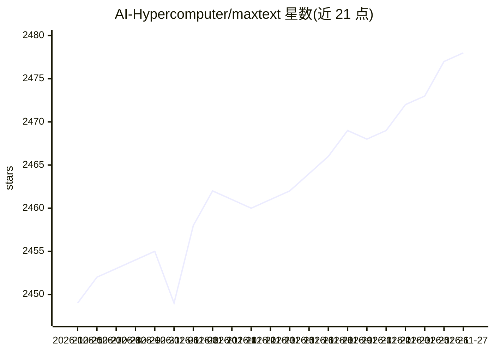

# AI-Hypercomputer/maxtext

⭐ 2,478 · Python · Apache-2.0 · 推送 2026-11-26 · [GitHub](https://github.com/AI-Hypercomputer/maxtext) · [官网](https://maxtext.readthedocs.io) · 组织维护

**基于 JAX 的 LLM 训练库，供开发者做预训练与后训练**

MaxText 是纯 Python/JAX 编写的开源 LLM 库与参考实现，面向 Google Cloud TPU 与 GPU 进行训练。提供 Gemma、Llama、DeepSeek、Qwen、Mistral 等模型家族的实现，支持从单机到数万芯片规模的预训练，以及 SFT、GRPO、GSPO 等后训练技术。依托 JAX 与 XLA 编译器实现高 MFU 与吞吐，并提供分片、量化、checkpointing 的实现方案。通过 PyPI 安装，推荐 Python 3.12，也可使用预构建容器镜像。

## 筛选速览

| 维度 | 判定 | 备注 |
|---|---|---|
| AI 角色 | `ai-ecosystem` | LLM/agent 周边工具 |
| 许可风险 | `permissive` | Apache-2.0 |
| 部署形态 | `library` | 以包/库形式分发 |
| 模型依赖 | local-ok | 支持本地模型 |
| 硬件要求 | — | 无带数字的原话,不猜 |
| 安装摩擦 | `low` | 无编译、无系统依赖或容器化 |
| 成熟度 | — | 结构信号不足 |

## 能力要点

- 支持 Gemma/Llama/DeepSeek/Qwen/Mistral 等多家族模型的预训练与后训练
- SFT、GRPO、GSPO 等后训练技术，RL 采样借助 vLLM
- 借助 JAX 与 XLA 编译器，从单主机到超大规模集群运行
- 支持 Gemma 3/4 与 Llama 4 的多模态 VLM 训练

## 适用场景

- 在 TPU/GPU 上从零预训练自研大模型
- 对开源或专有模型做 SFT 或强化学习后训练
- 将后训练后的 checkpoint 交给 vLLM 部署服务
- 作为参考实现 fork 后修改做模型研究

## 场景标签

`模型训练` `微调` `强化学习` · 领域:训练与推理

## 证据(README 行号)

> L9: MaxText is a high performance, highly scalable, open-source LLM library and reference implementation written in pure
> L11: MaxText provides a library of high performance models to choose from, including Gemma, Llama, DeepSeek, Qwen, and M
> L19: ## Installation

## 星数曲线

2026-10-25 2,449 → 2026-11-27 2,478（+29）

---
*卡片 v1 · prompt 1.4 · 生成 2026-11-26 · 置信度 high · 依据 README sha `6a6206ae68e4` · [字段定义](../../DATASET.md)*
