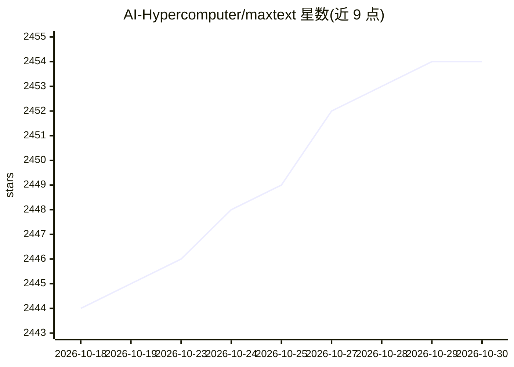

# AI-Hypercomputer/maxtext

⭐ 2,454 · Python · Apache-2.0 · 推送 2026-10-29 · [GitHub](https://github.com/AI-Hypercomputer/maxtext) · [官网](https://maxtext.readthedocs.io) · 组织维护

**面向 TPU/GPU 的 JAX LLM 训练库：预训练与后训练多种开源模型**

Google AI Hypercomputer 组织维护的高性能、可扩展 LLM 库与参考实现，以纯 Python/JAX 编写，面向 Google Cloud TPU 与 GPU 训练。提供 Gemma、Llama、DeepSeek、Qwen、Kimi、Mistral、GPT-OSS 等模型实现，支持大规模预训练（可扩展至数万芯片）与 SFT、GRPO、GSPO 等后训练技术（RL 采样借助 vLLM），并支持 Gemma 3/4 与 Llama 4 的多模态训练。通过 PyPI 安装或使用预构建容器镜像，另有无 GCP 依赖的 decoupled 模式；main 分支不保证生产就绪。

## 筛选速览

| 维度 | 判定 | 备注 |
|---|---|---|
| AI 角色 | `ai-ecosystem` | LLM/agent 周边工具 |
| 许可风险 | `permissive` | Apache-2.0 |
| 部署形态 | `library` | 以包/库形式分发 |
| 模型依赖 | local-ok | 支持本地模型 |
| 硬件要求 | — | 无带数字的原话,不猜 |
| 安装摩擦 | `low` | 无编译、无系统依赖或容器化 |
| 成熟度 | — | 结构信号不足 |

## 能力要点

- 提供 Gemma/Llama/DeepSeek/Qwen/Kimi/Mistral/GPT-OSS 等模型实现
- 预训练支持数万芯片规模，后训练支持 SFT/GRPO/GSPO
- 支持 Gemma 3/4 与 Llama 4 的多模态训练
- 提供无 GCP 依赖的 decoupled 模式与 PyPI 安装

## 适用场景

- 在 TPU/GPU 上从零预训练稠密或 MoE 模型
- 对自有或开源模型做 SFT/RL 后训练
- 参考其分片、量化、checkpoint 实现做模型设计实验

## 场景标签

`模型训练` `微调` `强化学习` · 领域:训练与推理

## 证据(README 行号)

> L13: MaxText is a high performance, highly scalable, open-source LLM library and reference implementation written in pur
> L15: MaxText provides a library of high performance models to choose from, including Gemma, Llama, DeepSeek, Qwen, and M
> L78: MaxText provides a library of models and demonstrates how to perform pre-training or post-training with high perfor

## 星数曲线

2026-10-18 2,444 → 2026-10-30 2,454（+10）

---
*卡片 v1 · prompt 1.4 · 生成 2026-10-21 · 置信度 high · 依据 README sha `7884e5742c85` · [字段定义](../../DATASET.md)*
