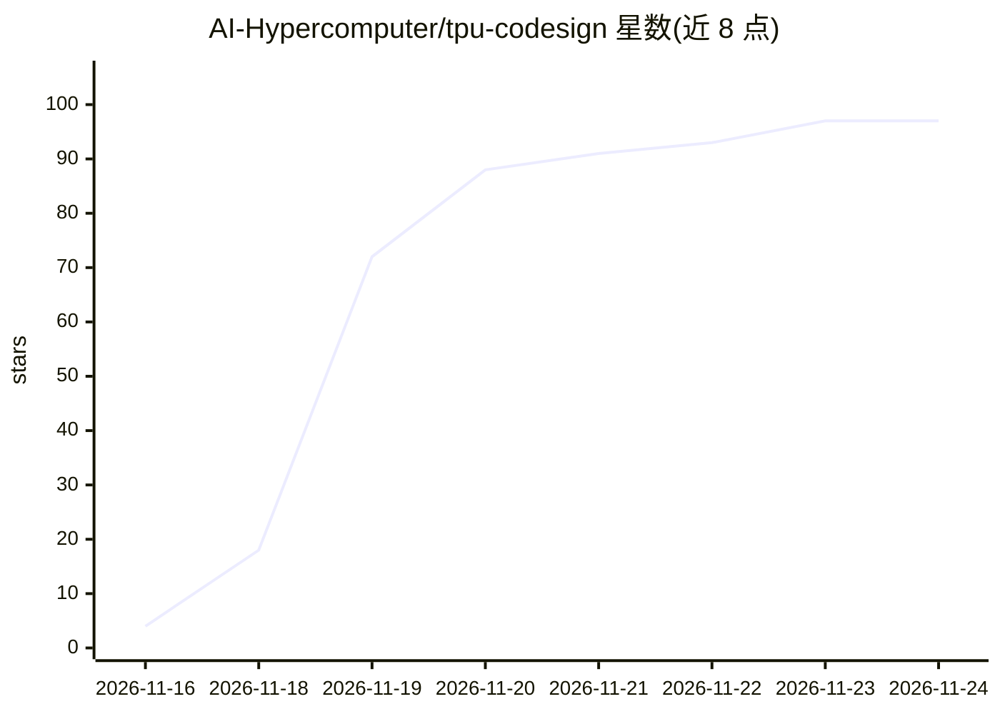

# AI-Hypercomputer/tpu-codesign

⭐ 97 · Apache-2.0 · 推送 2026-11-21 · [GitHub](https://github.com/AI-Hypercomputer/tpu-codesign) · [官网](https://ai-hypercomputer.github.io/tpu-codesign/) · 组织维护

**面向 Google Cloud TPU 的模型架构设计与优化指南（在线书籍）**

由 AI-Hypercomputer（Google）维护的活文档/在线书籍：提供基于硬件事实的模型架构设计原则（13 条）、MoE 协同设计模式（如 LatentMoE、共享专家）、低精度数值规则（FP8 block size 等）、并行性与系统映射指南，以及约 100B 参数 Ironwood LatentMoE 参考配置。面向在 TPU v7x（Ironwood）及后续代际上训练和推理 LLM/MoE 的工程与研究人员。站点由 docs/ 下 Markdown 经 Material for MkDocs 构建，可本地预览。

## 筛选速览

| 维度 | 判定 | 备注 |
|---|---|---|
| AI 角色 | `ai-knowledge` | 知识聚合/清单类 |
| 许可风险 | `permissive` | Apache-2.0 |
| 部署形态 | `library` | 以包/库形式分发 |
| 模型依赖 | — | README 未给出锁定关系 |
| 硬件要求 | — | 无带数字的原话,不猜 |
| 安装摩擦 | `low` | 无编译、无系统依赖或容器化 |
| 成熟度 | — | 结构信号不足 |

## 能力要点

- 13 条硬件导向设计原则，含每章质量风险分级
- 覆盖 MoE 协同设计、FP8 低精度数值、并行性映射（D2D/ICI torus/DCN）
- 提供约 100B 参数 Ironwood LatentMoE 参考配置与 XProf 诊断清单
- 以在线书籍/博客与单页 Markdown 两种形式提供

## 适用场景

- 在 Google Cloud TPU 上设计或改造 LLM/MoE 架构时查阅设计原则
- 训练/推理部署前核对低精度数值与并行策略选择
- 按 6 信号 XProf 清单排查 TPU 性能问题

## 场景标签

`模型训练` `模型量化` `教程课程` · 领域:学习与行业

## 证据(README 行号)

> L5: Google designed TPUs from the ground up for machine learning efficiency and performance per total cost of ownership 
> L7: * **Online Book & Blog:** <https://ai-hypercomputer.github.io/tpu-codesign/>
> L25: The book and blog are built from the Markdown files in `docs/` using Material for MkDocs:

## 星数曲线

2026-11-16 4 → 2026-11-24 97（+93）

---
*卡片 v1 · prompt 1.4 · 生成 2026-11-18 · 置信度 high · 依据 README sha `1906566decfc` · [字段定义](../../DATASET.md)*
