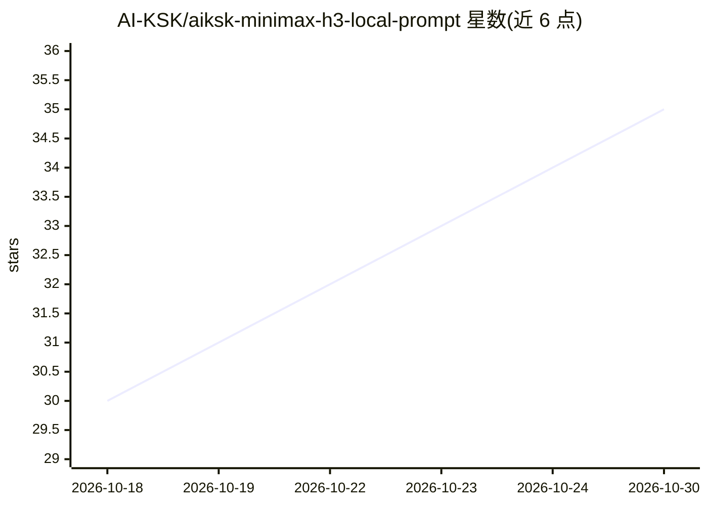

# AI-KSK/aiksk-minimax-h3-local-prompt

⭐ 35 · Python · Apache-2.0 · 推送 2026-10-14 · [GitHub](https://github.com/AI-KSK/aiksk-minimax-h3-local-prompt) · 个人维护 · 中文 README

**MiniMax H3 视频生成提示词工程 Skill 规范包**

面向 Claude / Codex 等 Agent 的本地提示词知识库：将创作者的自然语言、图片、视频、音频与镜头意图编译为 MiniMax H3 官方兼容提示词，覆盖 Base 与 Ref2VA 两大语法家族（t2v/i2v/fl2v/l2va 与 r2v/v2v/rv2v），并适配 AIMixer / ComfyUI_MiniMaxH3_Director 导演台。v1.8.1 增加武打/兵器/枪斗编排板块（动作编排、LoRA 预设、离线工作流同步脚本），附带结构测试脚本。不安装神经网络模型，输出需在 ComfyUI 中配合真实参考图使用。

## 筛选速览

| 维度 | 判定 | 备注 |
|---|---|---|
| AI 角色 | `ai-knowledge` | 知识聚合/清单类 |
| 许可风险 | `permissive` | Apache-2.0 |
| 部署形态 | `None` |  |
| 模型依赖 | — | README 未给出锁定关系 |
| 硬件要求 | — | 无带数字的原话,不猜 |
| 安装摩擦 | `low` | 无编译、无系统依赖或容器化 |
| 成熟度 | `idea` | |

## 能力要点

- Base 四段 / Ref2VA 六段式提示词语法规范
- 武打/双人攻防/兵器/枪斗编排规则与 A0–A8 LoRA 预设
- scripts/sync_fight_workflow.py 离线工作流同步器
- 提供 SKILL.md 与结构测试（输出 OK v1.8.1）

## 适用场景

- 让 Agent 把自然语言需求编译成 MiniMax H3 官方格式提示词
- 在 AIMixer Director / ComfyUI 中做多镜头人物一致性视频生成
- 编排 5/10/15 秒武打攻防视频的提示词与预设

## 场景标签

`提示工程` `视频生成` · 领域:Agent 开发

## 证据(README 行号)

> L5: 核心目标不是“写得像提示词”，而是让 Claude / Codex / 其他 Agent 能稳定把创作者的自然语言需求、图片、视频、音频和镜头意图，编译成 **MiniMax H3 官方兼容的完整提示词**，并且能够正确服务于 **
> L83: 1. `SKILL.md`

## 星数曲线

2026-10-18 30 → 2026-10-30 35（+5）

---
*卡片 v1 · prompt 1.4 · 生成 2026-10-25 · 置信度 high · 依据 README sha `63095f17a57e` · [字段定义](../../DATASET.md)*
