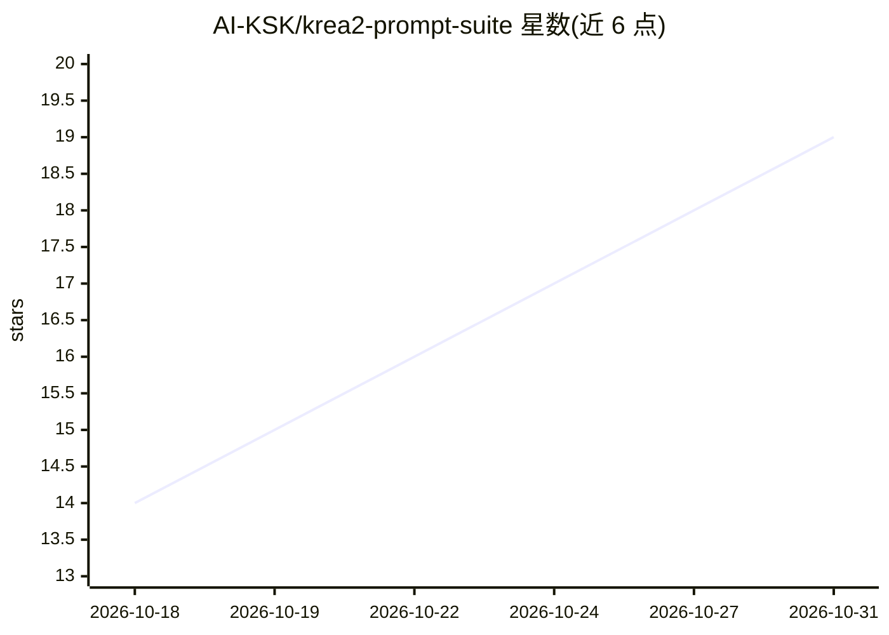

# AI-KSK/krea2-prompt-suite

⭐ 19 · Python · 推送 2026-07-20 · [GitHub](https://github.com/AI-KSK/krea2-prompt-suite) · 组织维护 · 中文 README

**面向 Krea 2 文生图的 Codex 技能：提示词创建、反推与修复**

一个安装到 Codex skills 目录的技能包，围绕 Krea 2 文生图模型提供提示词全流程处理：创建、扩写、精修、从图像反推提示词、修复失败生成（仅重写损坏模块）、从 SDXL/Pony/FLUX/Midjourney/Ideogram/中文速记等格式转换，以及排版文字提示词与批量变体。内置 K2-SCENE 十一层提示词架构、RAW/Turbo/Hosted 三类模型表面的区分说明、ComfyUI/RunningHub/Qwen3-VL 节点系统提示词，以及从结构化 JSON 生成提示词的确定性编译脚本。通过 git clone 或复制文件夹安装。

## 筛选速览

| 维度 | 判定 | 备注 |
|---|---|---|
| AI 角色 | `ai-ecosystem` | LLM/agent 周边工具 |
| 许可风险 | `none` | — |
| 部署形态 | `None` |  |
| 模型依赖 | — | README 未给出锁定关系 |
| 硬件要求 | — | 无带数字的原话,不猜 |
| 安装摩擦 | `low` | 无编译、无系统依赖或容器化 |
| 成熟度 | — | 结构信号不足 |

## 能力要点

- 12 种模式路由：create/reverse/repair/convert/evaluate/batch 等
- K2-SCENE 十一层提示词架构（媒介、主体、构图、光线、排版等）
- 区分 Krea 2 RAW/Turbo 与 Hosted Medium/Large 的提示词策略
- 附 JSON schema、确定性提示词编译脚本与自检脚本

## 适用场景

- 把概念或短提示词整理成 Krea 2 自然语言提示词
- 从参考图反推提示词并规划图像复现
- 把 Midjourney/FLUX/中文速记等格式提示词转为 Krea 2 风格
- 诊断失败生成并只重写损坏的提示词模块

## 场景标签

`提示工程` · 领域:Agent 开发

## 证据(README 行号)

> L3: Krea 2 Prompt Suite is a Codex skill for creating, reverse-engineering, repairing, converting, evaluating, and batch
> L94: - `SKILL.md` - main Codex skill instructions and routing.
> L109: Clone or copy this repository into your Codex skills directory:

## 星数曲线

2026-10-18 14 → 2026-10-31 19（+5）

---
*卡片 v1 · prompt 1.4 · 生成 2026-10-29 · 置信度 high · 依据 README sha `581c91f0c4a4` · [字段定义](../../DATASET.md)*
