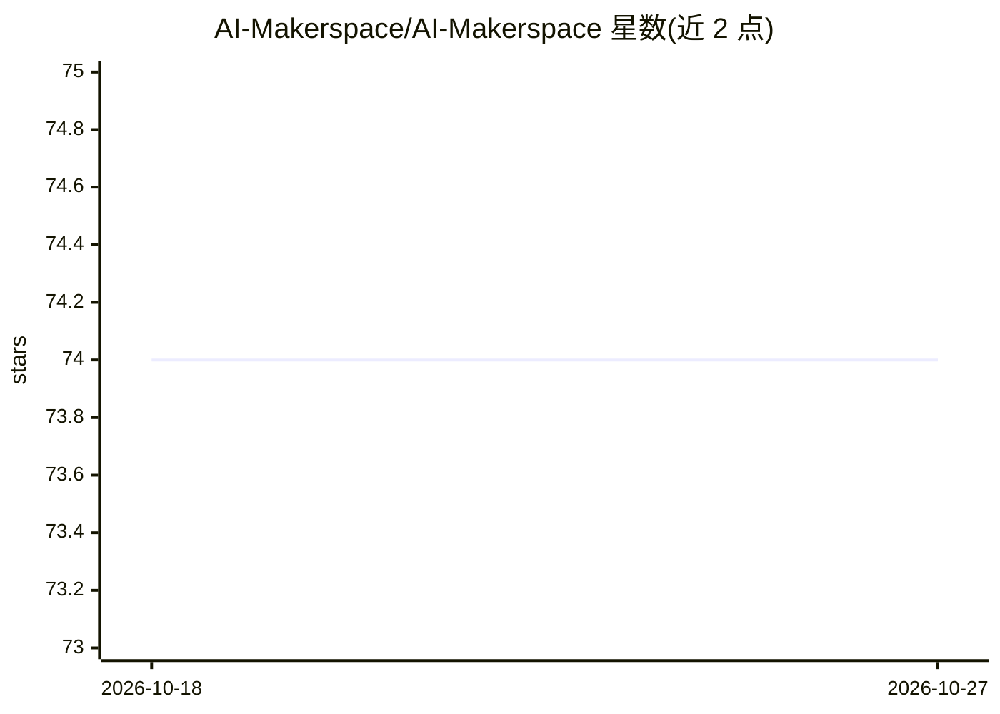

# AI-Makerspace/AI-Makerspace

⭐ 74 · JavaScript · Apache-2.0 · 推送 2026-03-16 · [GitHub](https://github.com/AI-Makerspace/AI-Makerspace) · [官网](https://www.linkedin.com/showcase/ai-makerspace/?viewAsMember=true) · 组织维护

**面向 AI 应用开发的代码模板与用例示例合集**

为跨职能创新团队提供 AI 应用的蓝图模板与用例示例：仓库按文件夹组织，覆盖 HuggingFace、VertexAI、FastAPI、SageMaker 等平台，MCP、CrewAI、PyTorch 等工具框架，以及 RAG、聊天机器人、情感检测、图像生成、语音识别等约 20 类应用示例。定位为 AI Design Thinking、Lean AI Engineering、XAI、负责任 AI 与机器学习产品 UX 开发过程的支持材料，另含 Agentic AI Coaching 项目与 Wiki 策展资源清单。README 未给出具体安装或运行命令。

## 筛选速览

| 维度 | 判定 | 备注 |
|---|---|---|
| AI 角色 | `ai-knowledge` | 知识聚合/清单类 |
| 许可风险 | `permissive` | Apache-2.0 |
| 部署形态 | `None` |  |
| 模型依赖 | — | README 未给出锁定关系 |
| 硬件要求 | — | 无带数字的原话,不猜 |
| 安装摩擦 | `low` | 无编译、无系统依赖或容器化 |
| 成熟度 | — | 结构信号不足 |

## 能力要点

- 按文件夹自解释的代码模板与用例示例结构
- 覆盖 12 类平台与 16 类工具/框架的探索清单
- 约 20 类应用示例：RAG、聊天机器人、图像生成、语音识别等
- Wiki 页面提供策展 AI 原型资源清单

## 适用场景

- 查找某种技术栈对应的 AI 应用蓝图模板起步开发
- 跨职能团队按 AI Design Thinking / Lean AI Engineering 流程开展原型开发
- 浏览不同 AI 用例类型寻找参考实现

## 场景标签

`精选清单` `教程课程` · 领域:学习与行业

## 证据(README 行号)

> L6: The code templates and use case examples provided in this repository are intended to guide development of AI applica
> L10: :octocat: Each folder of our GitHub repository is self-explanatory for using the blueprint templates of selected te

## 星数曲线

2026-10-18 74 → 2026-10-27 74（+0）

---
*卡片 v1 · prompt 1.4 · 生成 2026-10-24 · 置信度 mid · 依据 README sha `dddaa86e4026` · [字段定义](../../DATASET.md)*
