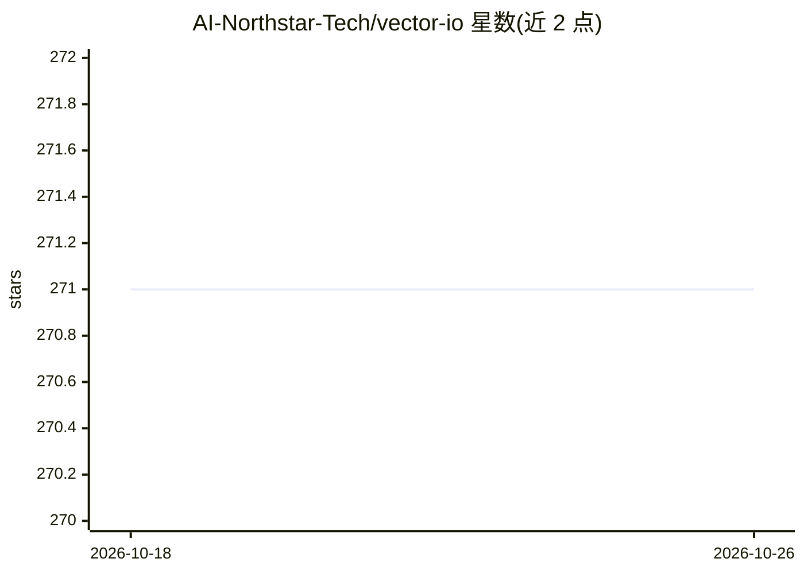

# AI-Northstar-Tech/vector-io

⭐ 271 · Jupyter Notebook · Apache-2.0 · 推送 2026-10-19 · [GitHub](https://github.com/AI-Northstar-Tech/vector-io) · [官网](https://vector-io.com) · 个人维护

**向量数据库通用导入导出工具：统一格式迁移与重嵌入向量数据**

面向使用向量数据库的开发者的 Python CLI 库（vdf-io）：定义通用向量数据集格式（VDF，由 VDF_META.json 与 Parquet 文件组成），提供 export_vdf/import_vdf 脚本在 Pinecone、Qdrant、Milvus、LanceDB、Chroma 等 9 种向量数据库间迁移数据，reembed_vdf 可用新模型对已导出数据集重嵌入，支持推送到 HuggingFace Hub。限制：Weaviate、pgvector、Redis 等多个数据库尚未支持；运行脚本会发送匿名遥测数据（可通过环境变量关闭）。

## 筛选速览

| 维度 | 判定 | 备注 |
|---|---|---|
| AI 角色 | `ai-ecosystem` | LLM/agent 周边工具 |
| 许可风险 | `permissive` | Apache-2.0 |
| 部署形态 | `library` | 以包/库形式分发 |
| 模型依赖 | — | README 未给出锁定关系 |
| 硬件要求 | — | 无带数字的原话,不猜 |
| 安装摩擦 | `low` | 无编译、无系统依赖或容器化 |
| 成熟度 | — | 结构信号不足 |

## 能力要点

- VDF 通用格式（VDF_META.json + Parquet）定义与导入导出脚本
- 9 种向量数据库完全支持导入与导出
- reembed_vdf 支持用任意新模型重嵌入文本列
- 文档给出新增向量数据库适配的类继承实现步骤

## 适用场景

- 在不同向量数据库之间迁移或备份向量数据
- 把向量数据集导出为 Parquet 后更换嵌入模型重新嵌入
- 将向量数据推送到 HuggingFace Hub 共享

## 场景标签

`向量数据库` · 领域:知识与检索

## 证据(README 行号)

> L10: This library uses a universal format for vector datasets to easily export and import data from all vector databases
> L106: ```bash

## 星数曲线



2026-10-18 271 → 2026-10-26 271（+0）


---
*卡片 v1 · prompt 1.4 · 生成 2026-10-22 · 置信度 high · 依据 README sha `690e83e7c912` · [字段定义](../../DATASET.md)*
