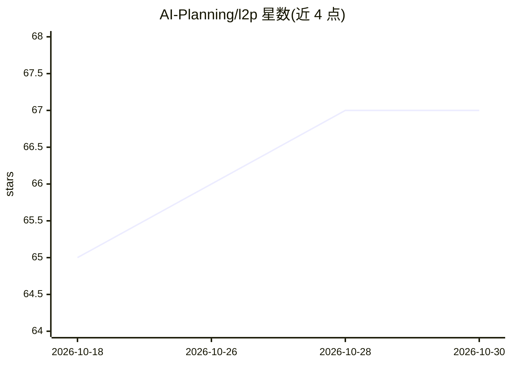

# AI-Planning/l2p

⭐ 67 · Python · MIT · 推送 2026-06-28 · [GitHub](https://github.com/AI-Planning/l2p) · 组织维护

**用 LLM 从自然语言生成 PDDL 规划模型的 Python 库**

由综述论文 LLMs as Planning Formalizers 扩展而来的库：封装 LLM 后端（OpenAI SDK 兼容模型、Claude、DeepSeek、本地 Ollama 等），通过 DomainBuilder 与 ProblemBuilder 将自然语言领域与任务描述转换为中间 PDDL 表示，再由经典规划器求解。内置 FastDownward 子模块（需自行克隆）与 Unified Planning 后端支持，提供抽象 Planner 类接入其他规划器，并附带面向 LLM agent 的非交互式 CLI。在 Python 3.11.10 环境下测试。

## 筛选速览

| 维度 | 判定 | 备注 |
|---|---|---|
| AI 角色 | `ai-native` | 本体是模型或模型工具 |
| 许可风险 | `permissive` | MIT |
| 部署形态 | `library` | 以包/库形式分发 |
| 模型依赖 | local-ok | 支持本地模型 |
| 硬件要求 | — | 无带数字的原话,不猜 |
| 安装摩擦 | `low` | 无编译、无系统依赖或容器化 |
| 成熟度 | — | 结构信号不足 |

## 能力要点

- 自然语言到 PDDL 领域/问题文件的生成（DomainBuilder/ProblemBuilder）
- UnifiedLLM 类统一接入 OpenAI SDK 兼容模型、Claude、DeepSeek 与本地 Ollama
- 内置 FastDownward 子模块与 Unified Planning 后端支持求解生成的 PDDL
- 面向 LLM agent 与自动化的非交互式 CLI（JSON schema 查询与构建命令）

## 适用场景

- 用自然语言描述规划领域并自动生成 PDDL 模型
- 接合经典规划器求解由 LLM 形式化的规划任务
- 在自动化流程中用 CLI 快速构建 PDDL 领域与问题文件

## 场景标签

`代码生成` · 领域:编码与开发

## 证据(README 行号)

> L7: This library is a collection of tools for PDDL model generation extracted from natural language driven by large lang
> L9: L2P is an offline, natural language-to-planning system (that wraps an LLM backend) to support domain-agnostic planni

## 星数曲线

2026-10-18 65 → 2026-10-30 67（+2）

---
*卡片 v1 · prompt 1.4 · 生成 2026-10-24 · 置信度 mid · 依据 README sha `876768d03137` · [字段定义](../../DATASET.md)*
