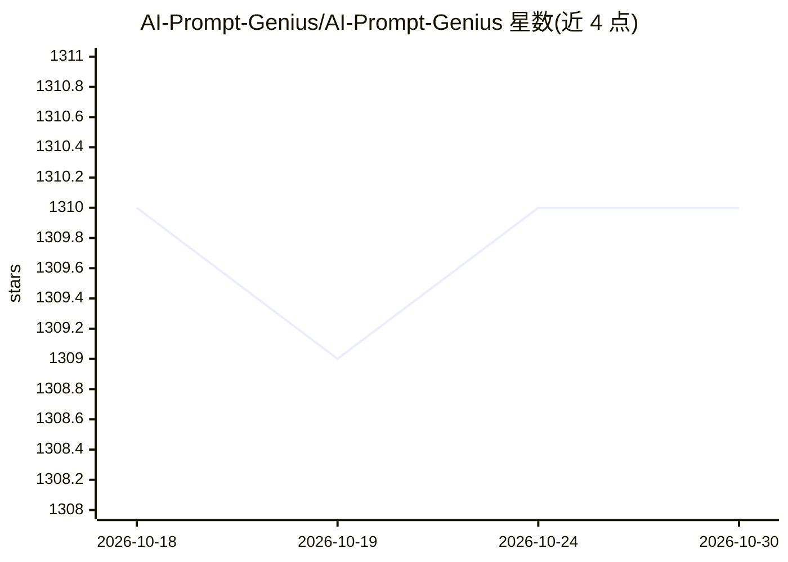

# AI-Prompt-Genius/AI-Prompt-Genius

⭐ 1,310 · TypeScript · 推送 2026-10-01 · [GitHub](https://github.com/AI-Prompt-Genius/AI-Prompt-Genius) · [官网](https://aipromptgenius.app/) · 个人维护

**管理个人 AI 提示词库的 Chrome 扩展**

Chrome 浏览器扩展，用于整理个人 AI 提示词库，用户可收藏、组织提示词并通过 Google 账号同步。技术栈为 React Web 应用与 Tailwind CSS（DaisyUI 组件）。通过 Chrome Web Store 安装；由于同步功能依赖 Google 认证，不支持 Firefox。许可证为 CC BY-NC-SA 4.0。项目另有 AIPromptGenius.app 网站提供更多信息。

## 筛选速览

| 维度 | 判定 | 备注 |
|---|---|---|
| AI 角色 | `ai-ecosystem` | LLM/agent 周边工具 |
| 许可风险 | `none` | — |
| 部署形态 | `None` |  |
| 模型依赖 | — | README 未给出锁定关系 |
| 硬件要求 | — | 无带数字的原话,不猜 |
| 安装摩擦 | `low` | 无编译、无系统依赖或容器化 |
| 成熟度 | — | 结构信号不足 |

## 能力要点

- AI 提示词库的整理与管理
- 基于 Google 账号的同步
- React + Tailwind CSS/DaisyUI 技术栈

## 适用场景

- 收藏并分类管理常用 AI 提示词
- 跨设备同步个人提示词库

## 场景标签

`提示工程` · 领域:Agent 开发

## 证据(README 行号)

> L3: AI Prompt Genius is a Chrome extension that allows you to curate a custom library of AI Prompts. View AIPromptGenius

## 星数曲线

2026-10-18 1,310 → 2026-10-30 1,310（+0）

---
*卡片 v1 · prompt 1.4 · 生成 2026-10-21 · 置信度 high · 依据 README sha `2d2468e444aa` · [字段定义](../../DATASET.md)*
