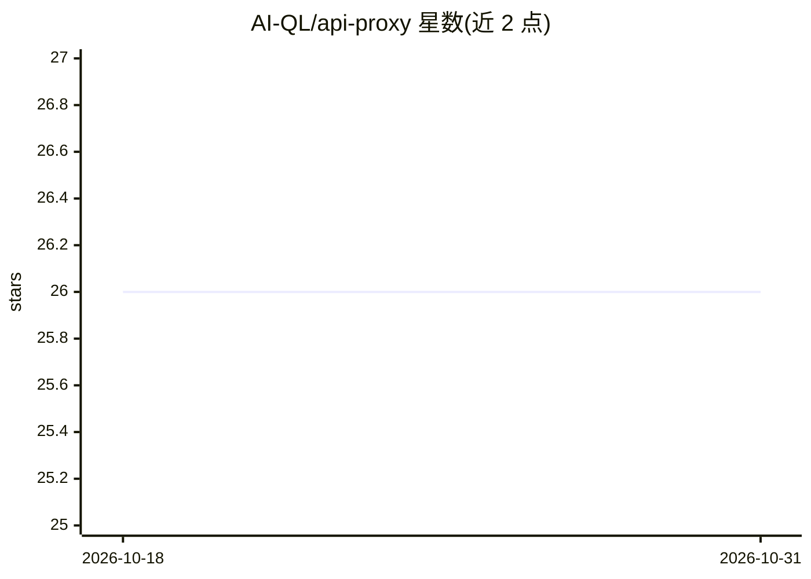

# AI-QL/api-proxy

⭐ 26 · JavaScript · Apache-2.0 · 推送 2026-10-20 · [GitHub](https://github.com/AI-QL/api-proxy) · [官网](https://api.aiql.com/) · 组织维护

**API 网关代理：解决地域限制、CORS 与 TLS 校验下的 API 访问**

提供 Docker 镜像与 NPX 两种方式的通用 API 代理，对 OpenAI API 等 OpenAI 格式后端做专门适配。作为应用与目标 API 之间的网关运行，通过环境变量配置端口、目标 URL、Host 头与 TLS 校验开关；用途包括绕过地域限制访问 OpenAI API、突破 CORS 限制、绕过企业自签名证书的 TLS 校验问题，以及自定义 Host 头路由。Docker Compose 示例覆盖 Nvidia NIM 等后端与自有域名 HTTPS 部署。

## 筛选速览

| 维度 | 判定 | 备注 |
|---|---|---|
| AI 角色 | `ai-ecosystem` | LLM/agent 周边工具 |
| 许可风险 | `permissive` | Apache-2.0 |
| 部署形态 | `self-host` | docker 或自建部署 |
| 模型依赖 | — | README 未给出锁定关系 |
| 硬件要求 | — | 无带数字的原话,不猜 |
| 安装摩擦 | `low` | 无编译、无系统依赖或容器化 |
| 成熟度 | — | 结构信号不足 |

## 能力要点

- Docker 镜像一键部署，默认端口 9017 代理 api.openai.com
- NPX 本地运行：npx @ai-ql/api-proxy --target --port
- PORT/TARGET/HOST/SECURE 四个环境变量配置代理行为
- 适用于任何遵循 OpenAPI 格式的后端 API

## 适用场景

- 在 OpenAI API 被地域屏蔽的地区通过代理继续调用
- 前端跨域访问缺少 CORS 头的私有 API
- 企业内网自签名证书环境下让常用库正常通过 TLS 校验
- 为 Nvidia NIM 等 OpenAI 格式后端搭建自定义域名网关

## 场景标签

 · 领域:LLM 基础设施/API 代理

## 证据(README 行号)

> L10: This repository offers both Dockerized and local proxy solutions for accessing any API, with specialized support fo
> L12: With the Docker image, you can easily deploy a proxy instance to serve as a gateway between your application and th
> L52: You can change default port and default target by setting `-e` in docker, which means that you can use it for any b

## 星数曲线

2026-10-18 26 → 2026-10-31 26（+0）

---
*卡片 v1 · prompt 1.4 · 生成 2026-10-26 · 置信度 high · 依据 README sha `dd919c81e8c9` · [字段定义](../../DATASET.md)*
