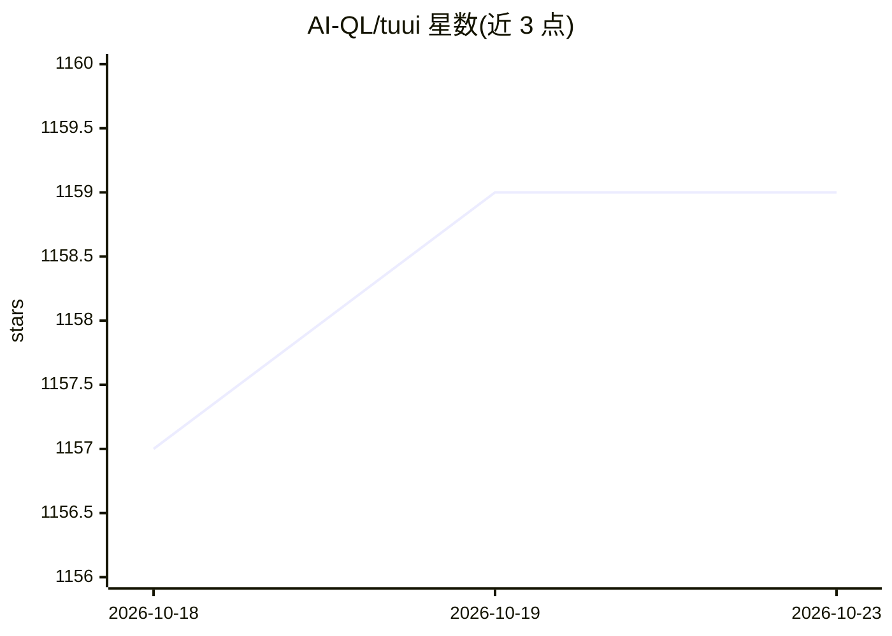

# AI-QL/tuui

⭐ 1,159 · TypeScript · Apache-2.0 · 推送 2026-05-14 · [GitHub](https://github.com/AI-QL/tuui) · [官网](https://www.tuui.com/) · 个人维护 · 中文 README

**本地桌面 MCP 客户端：跨厂商 LLM 聊天与工具集成**

基于 MCP 协议的桌面 LLM 聊天应用（TUUI）：支持 Tools/Prompts/Resources/Sampling/Elicitation 等 MCP 服务端与客户端能力，提供 MCP Registry 实时发现、MCP Bundles(.mcpb)、工具调用追踪与 Agent 指定工具选择。LLM 后端通过 llm.json 动态配置（支持 JSON 数组多聊天机器人），可接 ChatGPT、Claude、Qwen 或自托管后端。运行 MCP 相关功能需预置支持工具调用的 LLM 后端，NPX/UVX 类服务器需另装 Node.js 或 Python+UV。项目大量组件由 AI 生成，继续开发需使用其 lint 工具。

## 筛选速览

| 维度 | 判定 | 备注 |
|---|---|---|
| AI 角色 | `ai-native` | 本体是模型或模型工具 |
| 许可风险 | `permissive` | Apache-2.0 |
| 部署形态 | `desktop` | 安装包/桌面程序 |
| 模型依赖 | — | README 未给出锁定关系 |
| 硬件要求 | — | 无带数字的原话,不猜 |
| 安装摩擦 | `low` | 无编译、无系统依赖或容器化 |
| 成熟度 | — | 结构信号不足 |

## 能力要点

- Tools/Prompts/Resources/Sampling/Elicitation 等 MCP 能力矩阵
- MCP Registry 实时服务发现与 MCP Bundles(.mcpb) 支持
- llm.json 动态配置跨厂商 LLM API，支持多聊天机器人
- MCP 工具调用追踪与 Agent 指定工具选择

## 适用场景

- 在本地桌面统一调用多个厂商的 LLM 并接入 MCP 工具
- 通过 MCP Registry 发现并连接远程/本地 MCP 服务器
- 调试与追踪 MCP 工具调用过程

## 场景标签

`聊天机器人` · 领域:对话与助手

## 证据(README 行号)

> L3: #### TUUI is a desktop MCP client designed as a tool unitary utility integration, accelerating AI adoption through t
> L11: This repository is essentially an **LLM chat desktop application based on MCP**. It also represents a bold experime

## 星数曲线

2026-10-18 1,157 → 2026-10-23 1,159（+2）

---
*卡片 v1 · prompt 1.4 · 生成 2026-10-21 · 置信度 mid · 依据 README sha `454ced479a2b` · [字段定义](../../DATASET.md)*
