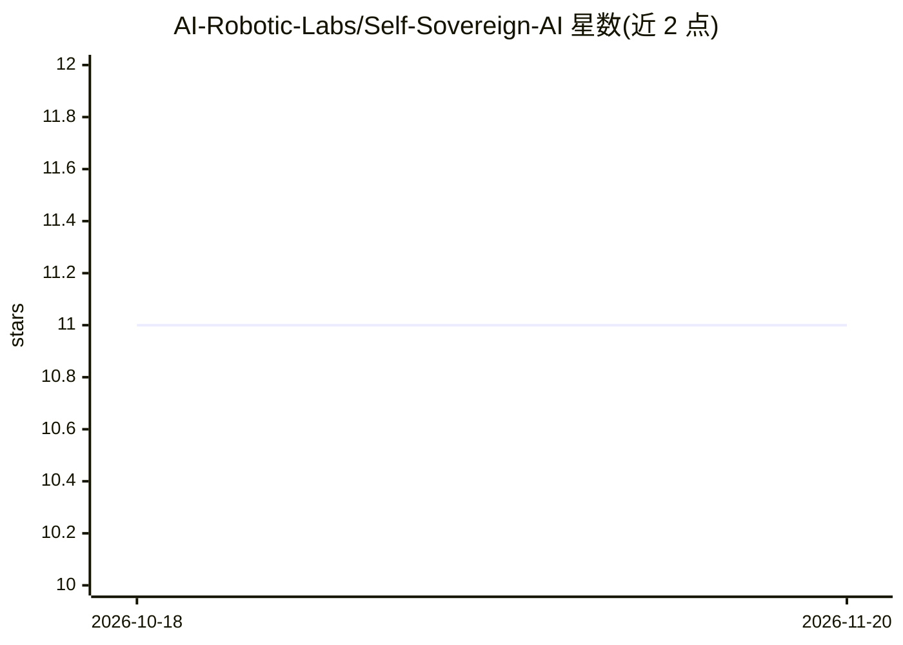

# AI-Robotic-Labs/Self-Sovereign-AI

⭐ 11 · Rust · GPL-3.0 · 推送 2026-11-17 · [GitHub](https://github.com/AI-Robotic-Labs/Self-Sovereign-AI) · 个人维护

**自主、隐私保护的去中心化 AI 框架概念与设计**

提出 Self-Sovereign AI 概念框架：构建可独立运行、自主管理数据的 AI 系统，通过去中心化标识符（DIDs）、Nostr、Pubky、去中心化存储、联邦学习与隐私保护技术实现无需中心化控制的安全交互。面向金融服务、去中心化数据市场、医疗等对独立性与安全性有要求的领域。当前 README 仅呈现概念描述，并声明本项目不发行任何代币，发现冒充者可举报；未提供安装或运行说明。

## 筛选速览

| 维度 | 判定 | 备注 |
|---|---|---|
| AI 角色 | `ai-ecosystem` | LLM/agent 周边工具 |
| 许可风险 | `viral` | GPL-3.0 |
| 部署形态 | `None` |  |
| 模型依赖 | — | README 未给出锁定关系 |
| 硬件要求 | — | 无带数字的原话,不猜 |
| 安装摩擦 | `low` | 无编译、无系统依赖或容器化 |
| 成熟度 | — | 结构信号不足 |

## 能力要点

- 基于 DIDs、Nostr、Pubky 的去中心化身份与通信机制设计
- 结合去中心化存储与联邦学习的隐私保护架构
- 声明项目无代币，警惕仿冒

## 适用场景

- 探索 AI 系统的数据主权与去中心化治理设计
- 了解隐私保护 AI 的技术组合思路

## 场景标签

 · 领域:去中心化 AI 基础框架

## 证据(README 行号)

> L5: The concept of Self-Sovereign AI proposes a framework for creating autonomous artificial intelligence (AI) that oper
> L7: ## Warming ⚠️

## 星数曲线

2026-10-18 11 → 2026-11-20 11（+0）

---
*卡片 v1 · prompt 1.4 · 生成 2026-11-19 · 置信度 low · 依据 README sha `45127b57d52d` · [字段定义](../../DATASET.md)*
