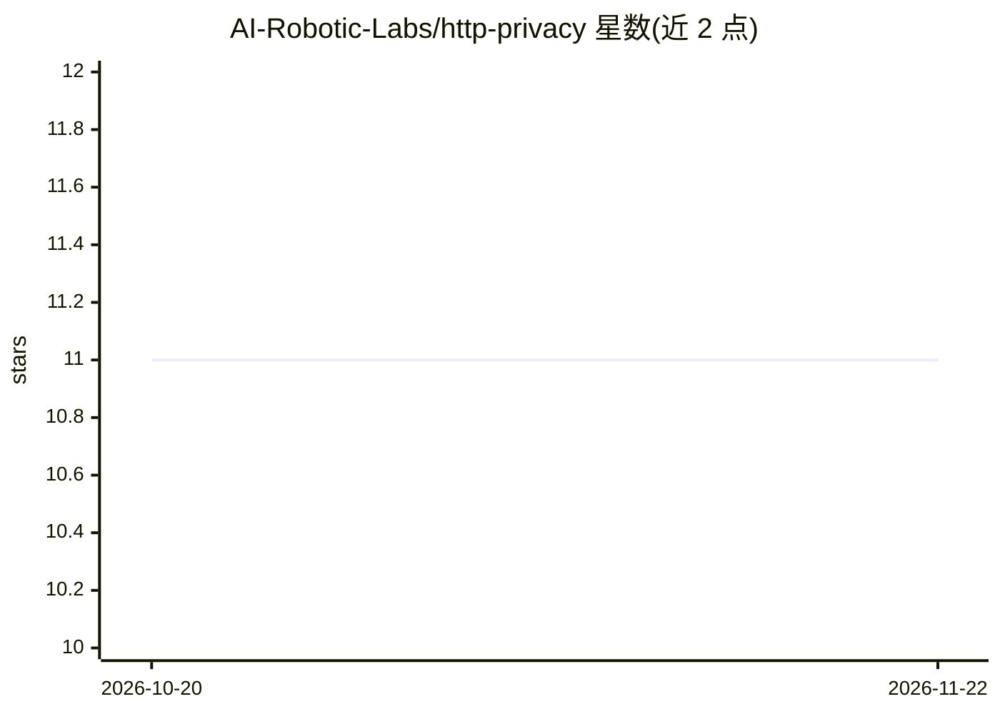

# AI-Robotic-Labs/http-privacy

⭐ 11 · Rust · MIT · 推送 2026-11-21 · [GitHub](https://github.com/AI-Robotic-Labs/http-privacy) · [官网](https://docs.rs/privacy_http_sdk/) · 个人维护

**以 HTTP 方式调用多家 AI API 并注重隐私的库**

一个提供 HTTP（REST/GET）接口访问 AI API 的项目，支持调用 OpenAI、Claude、xAI 等服务，以 Rust 与 C++ 实现，并提供 JavaScript 与 Python 绑定，发布于 crates.io、NPM 与 PyPI。功能包括跨 AI 服务的 REST/GET API、MCP Server、A2A 兼容与模型提示。README 提供本地运行 HTTP 服务器的文档链接与协议规范、外部绑定构建的说明，但未给出具体安装命令或使用示例。

## 筛选速览

| 维度 | 判定 | 备注 |
|---|---|---|
| AI 角色 | `ai-ecosystem` | LLM/agent 周边工具 |
| 许可风险 | `permissive` | MIT |
| 部署形态 | `library` | 以包/库形式分发 |
| 模型依赖 | — | README 未给出锁定关系 |
| 硬件要求 | — | 无带数字的原话,不猜 |
| 安装摩擦 | `low` | 无编译、无系统依赖或容器化 |
| 成熟度 | — | 结构信号不足 |

## 能力要点

- REST/GET API 跨多家 AI 服务（OpenAI、Claude、xAI）
- 提供 MCP Server 与 A2A 兼容能力
- Rust/C++ 实现，附 JavaScript 与 Python 绑定
- 发布于 crates.io、NPM、PyPI

## 适用场景

- 通过统一 HTTP 接口调用多家 AI 服务
- 搭建本地 HTTP 服务器访问 AI API
- 以 MCP 或 A2A 方式集成 AI 能力

## 场景标签

`模型网关` · 领域:Agent 开发

## 证据(README 行号)

> L11: HTTP and AI for privacy APIs
> L13: You can use AI APIs (OpenAI, Claude, xAI...) and others for get privacy using HTTP (REST/GET)
> L17: - REST/GET API cross from AIs

## 星数曲线

2026-10-20 11 → 2026-11-22 11（+0）

---
*卡片 v1 · prompt 1.4 · 生成 2026-11-19 · 置信度 low · 依据 README sha `bc76573308d3` · [字段定义](../../DATASET.md)*
