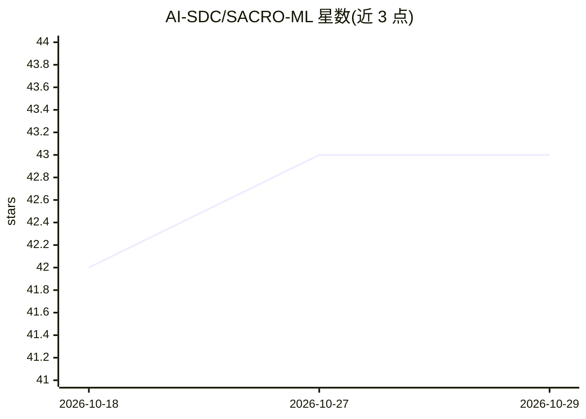

# AI-SDC/SACRO-ML

⭐ 43 · Python · MIT · 推送 2026-10-19 · [GitHub](https://github.com/AI-SDC/SACRO-ML) · [官网](https://ai-sdc.github.io/SACRO-ML/) · 组织维护

**评估已训练 ML 模型披露风险的统计披露控制工具集**

sacroml 包提供两套机制：safemodel 扩展常用 ML 模型，在训练前评估训练配置的理论披露风险，并采用差分隐私优化器等最佳实践；attacks 包在训练后通过多种模拟攻击（成员推断 LiRA、QMIA、属性推断及结构攻击）评估分类模型的实际披露风险，输出人类可读报告。支持 scikit-learn 与 PyTorch 模型，部分攻击可仅用预测概率 CSV 运行。由 UKRI DARE UK 相关项目支持，面向需要发布 ML 模型的研究环境。

## 筛选速览

| 维度 | 判定 | 备注 |
|---|---|---|
| AI 角色 | `ai-ecosystem` | LLM/agent 周边工具 |
| 许可风险 | `permissive` | MIT |
| 部署形态 | `library` | 以包/库形式分发 |
| 模型依赖 | — | README 未给出锁定关系 |
| 硬件要求 | — | 无带数字的原话,不猜 |
| 安装摩擦 | `low` | 无编译、无系统依赖或容器化 |
| 成熟度 | — | 结构信号不足 |

## 能力要点

- 训练前理论风险评估的 safemodel 包，支持差分隐私优化器
- 统一 API 的攻击套件：LiRA、QMIA、属性推断与低成本结构攻击
- 支持 scikit-learn 与 PyTorch 分类模型，仅凭预测概率 CSV 也可运行部分攻击
- 结果输出人类可读报告

## 适用场景

- 在发布 ML 模型前评估其泄露训练数据的风险
- 训练前筛查高风险配置，避免浪费资源训练披露性模型
- 对已训练分类模型执行成员推断攻击测试

## 场景标签

`网络安全` · 领域:学习与行业

## 证据(README 行号)

> L12: The `sacroml` package is a collection of tools and resources for managing the statistical disclosure control (SDC) 
> L14: * A **safemodel** package that extends commonly used ML models to provide *ante-hoc* SDC by assessing the theoretic
> L15: * An **attacks** package that provides *post-hoc* SDC by assessing the empirical disclosure risk of a classificatio

## 星数曲线

2026-10-18 42 → 2026-10-29 43（+1）

---
*卡片 v1 · prompt 1.4 · 生成 2026-10-25 · 置信度 high · 依据 README sha `4b81f80135a7` · [字段定义](../../DATASET.md)*
