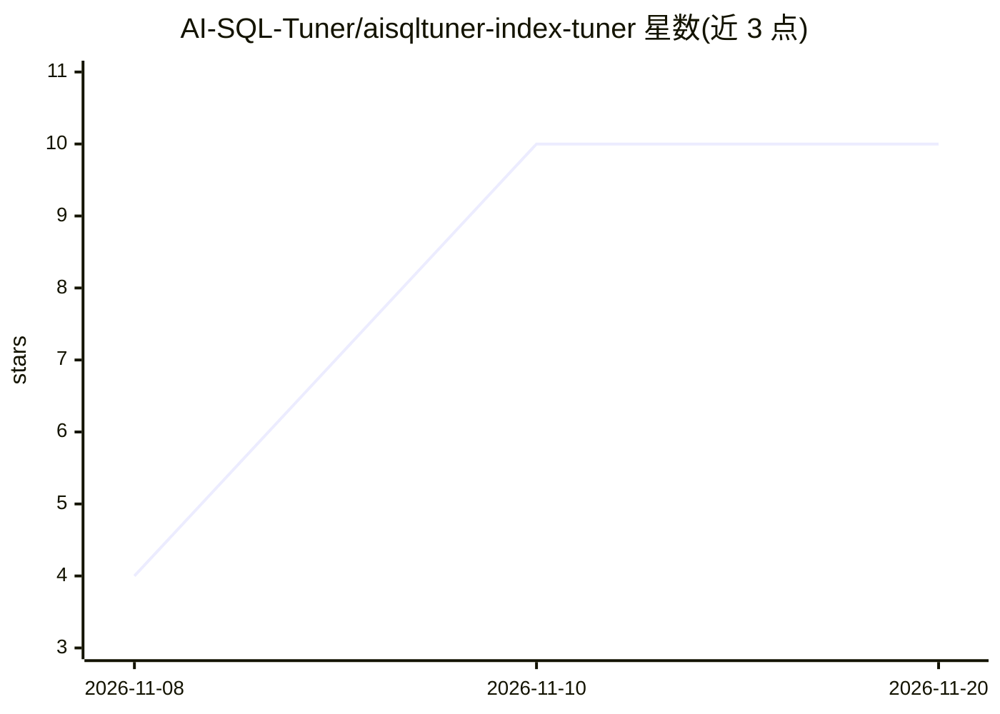

# AI-SQL-Tuner/aisqltuner-index-tuner

⭐ 10 · TSQL · MIT · 推送 2026-11-17 · [GitHub](https://github.com/AI-SQL-Tuner/aisqltuner-index-tuner) · [官网](https://aisqltuner.com) · 组织维护

**在 SQL Server 内运行的 AI 索引调优存储过程**

以单个 T-SQL 存储过程（sp_AIIndexTuner）形式部署在用户数据库内：收集缺失索引、冗余索引、非 SARGable 谓词、Query Store 查询等诊断数据，通过 sp_invoke_external_rest_endpoint 调用用户自有的 Azure OpenAI 部署，将建议按类别、优先级、置信度、预估存储变化存入表，并可在 CREATE 模式下应用已验证的新索引。需 SQL Server 2025 或对应更新策略的 Azure SQL 平台，仅支持 OpenAI 模型，MIT 许可。

## 筛选速览

| 维度 | 判定 | 备注 |
|---|---|---|
| AI 角色 | `ai-native` | 本体是模型或模型工具 |
| 许可风险 | `permissive` | MIT |
| 部署形态 | `None` |  |
| 模型依赖 | locked-api |  |
| 硬件要求 | — | 无带数字的原话,不猜 |
| 安装摩擦 | `low` | 无编译、无系统依赖或容器化 |
| 成熟度 | — | 结构信号不足 |

## 能力要点

- 一条存储过程完成诊断收集、模型调用、建议存储与索引创建
- 内置变更控制：允许/禁止 Columnstore、删索引、新索引数量上限与置信度阈值
- 后台响应轮询失败按 Retry-After 重试，放弃时取消响应以停止消耗 token
- 与商业版 AI SQL Tuner Studio 的功能对照表

## 适用场景

- 为 SQL Server 数据库自动生成并应用缺失索引建议
- 识别冗余与重复索引以回收存储
- 从 Query Store 中发现参数敏感查询并获取改写建议

## 场景标签

 · 领域:数据库/性能调优

## 证据(README 行号)

> L3: AI-assisted index tuning that runs entirely inside SQL Server. One stored procedure collects the
> L39:  a managed identity with the *Cognitive Services OpenAI User* role. Only OpenAI models are
> L63: |Applies recommendations|Yes: creates verified new indexes and, when allowed, drops indexes, within the change cont

## 星数曲线

2026-11-08 4 → 2026-11-20 10（+6）

---
*卡片 v1 · prompt 1.4 · 生成 2026-11-20 · 置信度 high · 依据 README sha `fdabc66cee2b` · [字段定义](../../DATASET.md)*
