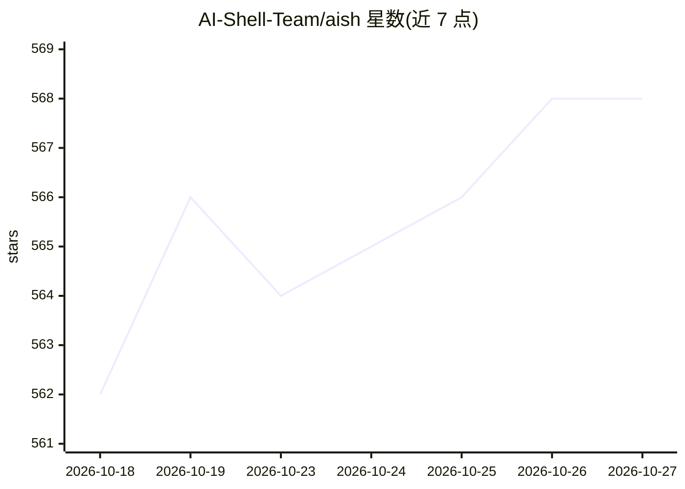

# AI-Shell-Team/aish

⭐ 568 · Rust · Apache-2.0 · 推送 2026-10-26 · [GitHub](https://github.com/AI-Shell-Team/aish) · [官网](https://www.aishell.ai) · 组织维护 · 中文 README

**面向运维排障的 AI Shell：自然语言生成并安全执行命令**

Rust 实现的交互式 AI Shell，提供完整 PTY 支持，可直接运行 vim/ssh/top 等交互程序。以 ; 前缀进入 AI 模式，用自然语言生成、解释并执行命令，内置 ReAct 诊断子代理与技能插件系统（支持热加载）。AI 生成的命令经风险分级（LOW/MEDIUM/HIGH）确认流程，可选沙箱预运行与 systemd 沙箱服务。模型通过 OpenAI 兼容接口配置（如 OpenRouter/DeepSeek），可选 Langfuse 观测。Linux 提供一键安装脚本与离线 bundle，也可 cargo 源码运行。

## 筛选速览

| 维度 | 判定 | 备注 |
|---|---|---|
| AI 角色 | `ai-native` | 本体是模型或模型工具 |
| 许可风险 | `permissive` | Apache-2.0 |
| 部署形态 | `None` |  |
| 模型依赖 | — | README 未给出锁定关系 |
| 硬件要求 | — | 无带数字的原话,不猜 |
| 安装摩擦 | `medium` | 含编译或系统依赖之一 |
| 成熟度 | — | 结构信号不足 |

## 能力要点

- 完整 PTY 支持，可运行 vim/ssh/top 等交互式程序
- AI 命令风险三级分级确认，可选沙箱预运行与回退策略
- 技能插件系统支持热加载与优先级覆盖，兼容 ~/.claude/skills
- 14 个 Rust crate 架构：SQLite 会话持久化、tiktoken 滑窗上下文、Markdown 长期记忆

## 适用场景

- 用自然语言描述任务让 AI 生成并执行运维命令
- 在同一个终端里兼顾日常命令操作与 AI 排障
- 生产环境经安全策略与沙箱预运行受控执行 AI 命令

## 场景标签

`AI 助手` · 领域:对话与助手

## 证据(README 行号)

> L20: - **AI Native Integration**: Describe tasks in natural language, generate, explain and execute commands
> L29: |🎯 **Core Positioning**|Ops/System Troubleshooting CLI|Development Coding Assistant|

## 星数曲线

2026-10-18 562 → 2026-10-27 568（+6）

---
*卡片 v1 · prompt 1.4 · 生成 2026-10-21 · 置信度 high · 依据 README sha `5831ccdb1fc9` · [字段定义](../../DATASET.md)*
