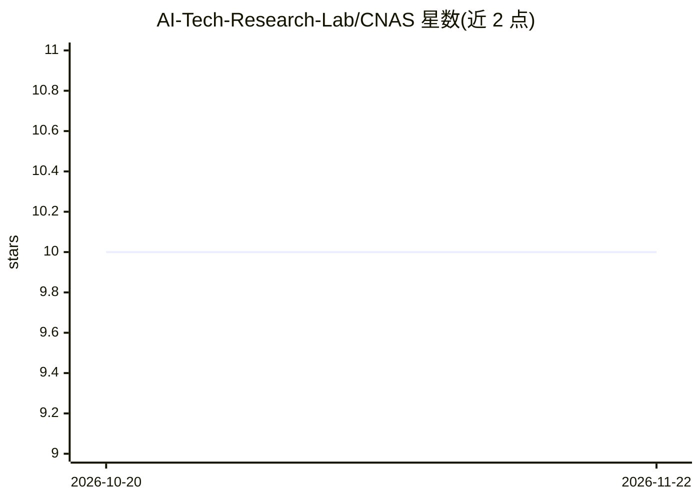

# AI-Tech-Research-Lab/CNAS

⭐ 10 · Python · Apache-2.0 · 推送 2025-12-10 · [GitHub](https://github.com/AI-Tech-Research-Lab/CNAS) · 组织维护

**面向研究者的约束式神经架构搜索框架**

基于 PyTorch 的神经架构搜索（NAS）框架：以数据集、评估超参、功能与技术约束及候选网络集合为输入，通过 NSGA-II 遗传算法做双目标优化（预测精度与复杂度），输出静态或自适应（如早退）网络。支持 OFA（MobileNetV3）与 NASBench201 两种搜索空间，覆盖参数量/MACs/OOD 鲁棒性等第二目标；搜索完成后可按偏好筛选架构并微调验证。搜索阶段示例使用 8 块 GPU。

## 筛选速览

| 维度 | 判定 | 备注 |
|---|---|---|
| AI 角色 | `ai-native` | 本体是模型或模型工具 |
| 许可风险 | `permissive` | Apache-2.0 |
| 部署形态 | `library` | 以包/库形式分发 |
| 模型依赖 | — | README 未给出锁定关系 |
| 硬件要求 | — | 无带数字的原话,不猜 |
| 安装摩擦 | `low` | 无编译、无系统依赖或容器化 |
| 成熟度 | — | 结构信号不足 |

## 能力要点

- NSGA-II 双目标搜索：精度 vs 参数量/MACs/激活规模等复杂度指标
- 支持 Early Exit 神经网络与 avg_macs 加权指标
- FLATNAS 式损失景观平坦度优化以提升 OOD 鲁棒性
- 支持 resume 断点续搜与按偏好筛选架构

## 适用场景

- 在给定算力/内存约束下搜索 MobileNetV3 子网
- 构建带早退分支的自适应网络并约束 MAC 开销
- 提升模型在扰动数据集（CIFAR-10-C 等）上的泛化

## 场景标签

 · 领域:AutoML/深度学习模型搜索

## 证据(README 行号)

> L1: This repository contains the code for a Neural Architecture Search (NAS) framework supporting for:
> L3: - different search spaces: Once-For-All (OFA)[2] (MobileNetV3 with resolutions ranging in 128 - 224) and NASBench201
> L18: - `Search Strategy`: the search strategy of the NAS. It performs a bi-objective optimization through a genetic algo

## 星数曲线

2026-10-20 10 → 2026-11-22 10（+0）

---
*卡片 v1 · prompt 1.4 · 生成 2026-11-20 · 置信度 high · 依据 README sha `be459edbdfc6` · [字段定义](../../DATASET.md)*
