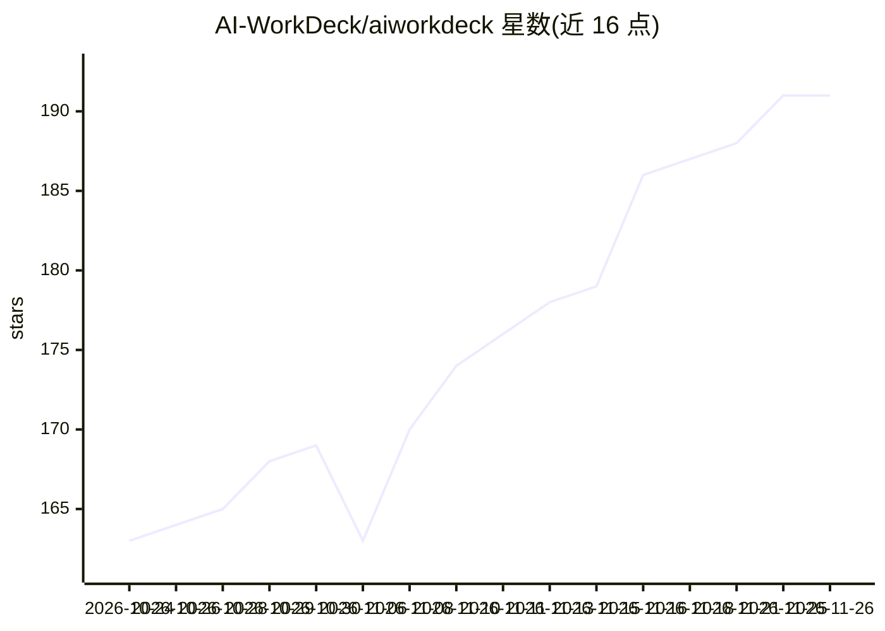

# AI-WorkDeck/aiworkdeck

⭐ 191 · JavaScript · AGPL-3.0 · 推送 2026-11-25 · [GitHub](https://github.com/AI-WorkDeck/aiworkdeck) · [官网](https://www.aiworkdeck.com) · 组织维护 · 中文 README

**面向律师的开源法律文档 AI 工作台**

将 IDE 形态引入法律工作：以案件（matter）组织文件与上下文，AI 直接在真实 Word 文档中以修订（tracked changes）形式写入改动，每处改动可接受或拒绝；每个结论带来源引用，点击可跳转到原文高亮段落并检测锚点变动；提供 Git 版本历史、三方文档合并与段落级溯源。桌面应用支持 Windows/macOS 与浏览器试用，内置 LibreOffice WASM 编辑器，提供插件 SDK、Skills 规范与一键安装插件/MCP 服务器的市场。文档默认本地存储，云模型与自托管需另行配置。

## 筛选速览

| 维度 | 判定 | 备注 |
|---|---|---|
| AI 角色 | `ai-native` | 本体是模型或模型工具 |
| 许可风险 | `dual` | AGPL-3.0 |
| 部署形态 | `None` |  |
| 模型依赖 | — | README 未给出锁定关系 |
| 硬件要求 | — | 无带数字的原话,不猜 |
| 安装摩擦 | `low` | 无编译、无系统依赖或容器化 |
| 成熟度 | — | 结构信号不足 |

## 能力要点

- AI 编辑以修订模式写入真实 Word 文档，逐条接受/拒绝
- 结论带来源引用链接，锚点变动或缺失常标记
- Git 版本历史、三方合并与段落级溯源
- 插件/Skills/MCP 服务器市场，付费上架作者获得 85% 净收入

## 适用场景

- 律师起草与审改诉状、合同等文书时逐条审阅 AI 改动
- 文书中每个论点核验对应证据原文
- 现场拍照录音自动归档到电脑端案卷
- 开发法律工作流插件或 Skill 并上架市场

## 场景标签

`文档问答` · 领域:知识与检索

## 证据(README 行号)

> L8:  AI WorkDeck brings that infrastructure to lawyers — organised by matter, every answer sourced, every change on the 
> L39:  AI edits the document itself. It writes straight into the real Word file as tracked changes, and you accept or rej
> L64: - **Run from source:** Getting started · Architecture. The contributor stack uses JDK 21, Maven, Node/npm and Postg
> L91: The steward is **北京公富信息技术有限公司 (BEIJING GONG FU INFORMATION TECHNOLOGY LIMITED)**. The same entity operates the dome

## 星数曲线

2026-10-24 163 → 2026-11-26 191（+28）

---
*卡片 v1 · prompt 1.4 · 生成 2026-11-26 · 置信度 high · 依据 README sha `eaa4eee214be` · [字段定义](../../DATASET.md)*
