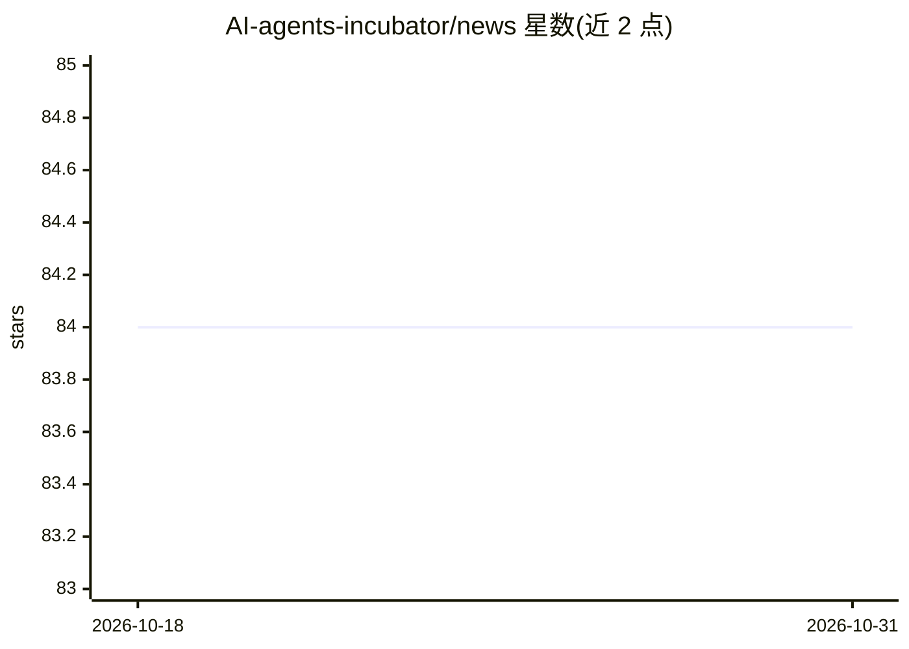

# AI-agents-incubator/news

⭐ 84 · JavaScript · 推送 2026-08-04 · [GitHub](https://github.com/AI-agents-incubator/news) · 个人维护

**自动新闻摘要流水线：收集新闻→LLM 生成评语→发布 Telegram/Facebook**

Node.js + SQLite 的自托管新闻摘要管道：用户在 Perplexity Discover 中浏览新闻，通过 Telegram bot 分享链接积累 13 篇以上文章后，调用 LLM（OpenAI 或 Anthropic，由 LLM_VENDOR 配置）按 prompt.md 与 assembly_prompt.md 两阶段生成带作者风格的摘要与评论，经 Web Dashboard 一键发布到 Telegram 频道或 Facebook Page（Graph API）。提供 Docker Compose 生产部署与 API 接口；作者声明另存在付费 Pro 版本（未公开发布），免费版（MIT）功能完整。个人项目，非商业化维护。

## 筛选速览

| 维度 | 判定 | 备注 |
|---|---|---|
| AI 角色 | `ai-native` | 本体是模型或模型工具 |
| 许可风险 | `permissive` | — |
| 部署形态 | `self-host` | docker 或自建部署 |
| 模型依赖 | — | README 未给出锁定关系 |
| 硬件要求 | — | 无带数字的原话,不猜 |
| 安装摩擦 | `low` | 无编译、无系统依赖或容器化 |
| 成熟度 | — | 结构信号不足 |

## 能力要点

- 两阶段 prompt 生成新闻评论与摘要（prompt.md + assembly_prompt.md）
- Dashboard 预览、发布到 Telegram / Facebook Page、复制文本
- 支持 OpenAI 与 Anthropic 两种 LLM 提供方（LLM_VENDOR 配置）
- fail-closed 认证、rate limiting、SSRF 白名单等安全机制

## 适用场景

- 运营自己的 Telegram/Facebook 新闻频道，自动生成带评语的摘要
- 内容创作者把日常看到的新闻整理成可发布的日报/周报
- 自托管一个带 Web 面板的新闻聚合发布服务

## 场景标签

`工作流自动化` `AI 写作` · 领域:效率与自动化

## 证据(README 行号)

> L14: > Автоматизированный пайплайн: собирает новости → генерирует авторские комментарии через OpenAI (GPT-5.6 Terra) → п
> L31: |Генерация авторских комментариев (GPT-5.6 Terra, 2 фазы)|✅|✅|
> L52: 4. Когда накопилось **13+ статей** — модель (OpenAI, GPT-5.6 Terra) автоматически генерирует дайджест; в Pro отдель

## 星数曲线

2026-10-18 84 → 2026-10-31 84（+0）

---
*卡片 v1 · prompt 1.4 · 生成 2026-10-24 · 置信度 high · 依据 README sha `5069ca3c8e2b` · [字段定义](../../DATASET.md)*
