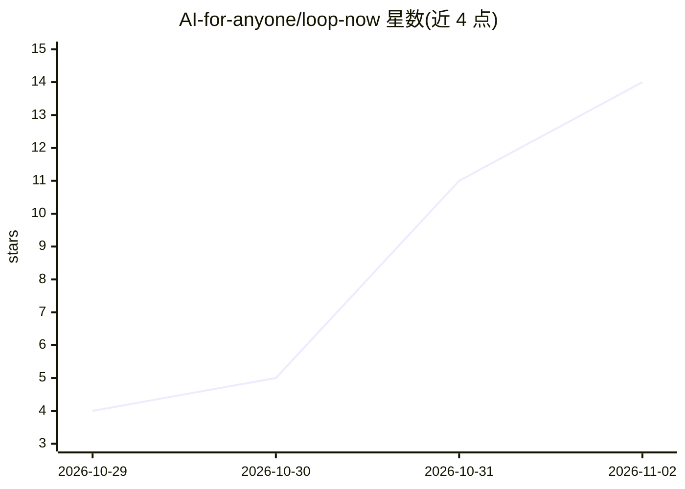

# AI-for-anyone/loop-now

⭐ 14 · Go · Apache-2.0 · 推送 2026-10-31 · [GitHub](https://github.com/AI-for-anyone/loop-now) · 组织维护 · 中文 README

**本地多 Agent 协作工作台，可插件扩展**

本地运行的多 Agent 工作区：在浏览器控制台中按项目组织 agent，为每个 agent 配置模型、指令、技能、仓库与工具权限，指定 Manager 协调任务流（条件分支、有界评审循环、重试）。以 Pi 为执行引擎，通过插件系统接入 CLI/MCP 工具、事件钩子与账户权限；随平台提供 webhook、playwright、hello 三个官方插件。支持 Docker Compose 一键部署或源码安装（需 Go、Node.js、PostgreSQL、Redis、Pi）。自我声明为早期个人版，控制台无登录，面向本机回环访问。

## 筛选速览

| 维度 | 判定 | 备注 |
|---|---|---|
| AI 角色 | `ai-ecosystem` | LLM/agent 周边工具 |
| 许可风险 | `permissive` | Apache-2.0 |
| 部署形态 | `self-host` | docker 或自建部署 |
| 模型依赖 | — | README 未给出锁定关系 |
| 硬件要求 | — | 无带数字的原话,不猜 |
| 安装摩擦 | `low` | 无编译、无系统依赖或容器化 |
| 成熟度 | `idea` | |

## 能力要点

- 按项目组织 agent 团队，Manager 通过任务工作流协调多个 agent
- 插件系统：agent 半（Pi 包）+ 平台半（事件订阅/API 调用）组合打包
- 事件持久化、重试、重启回放，插件隔离运行
- 随平台提供 webhook、playwright、hello 三个官方插件

## 适用场景

- 在本地搭建开发/评审多角色 agent 协作流程
- 通过插件接入 CLI 与 MCP 工具扩展团队能力
- 跟踪 agent 任务工作流、消息收件箱与 token 用量

## 场景标签

`多智能体` · 领域:Agent 开发

## 证据(README 行号)

> L18: Loop Now brings your agents into one browser workspace. An agent keeps its own working directory and conversation; 
> L22: The platform runs on your machine, with Pi as its execution engine. You choose the models, credentials, repositorie
> L20: **Plugins are the main extension point:** tools, event hooks, accounts, permissions, and resources can travel toget

## 星数曲线

2026-10-29 4 → 2026-11-02 14（+10）

---
*卡片 v1 · prompt 1.4 · 生成 2026-11-02 · 置信度 high · 依据 README sha `5b9ea322008b` · [字段定义](../../DATASET.md)*
