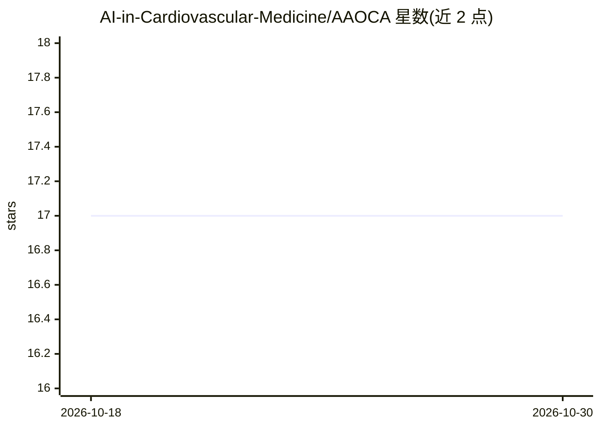

# AI-in-Cardiovascular-Medicine/AAOCA

⭐ 17 · Python · NOASSERTION · 推送 2026-05-21 · [GitHub](https://github.com/AI-in-Cardiovascular-Medicine/AAOCA) · [官网](https://mb-neuro.medical-blocks.ch/public_access/projects) · 组织维护

**AI 检测冠脉异常起源（AAOCA）的 CCTA 分析工具**

面向心血管影像研究的全自动化 AI 工具：读取冠脉 CT 血管造影（CCTA）图像，检测主动脉起源异常的冠状动脉（AAOCA）、分类其起源并评估解剖风险。流程含基于 nnUNet 的心脏分割、裁剪、重采样预处理，训练/评估采用 SEResNet-3D 架构，支持多模型集成推理与 GradCAM++ 可解释性热图，输出 CSV 预测。开发测试环境为 Ubuntu Linux，训练需 24GB 显存 GPU，推理可仅用 CPU；提供在线网页服务试用。

## 筛选速览

| 维度 | 判定 | 备注 |
|---|---|---|
| AI 角色 | `ai-native` | 本体是模型或模型工具 |
| 许可风险 | `none` | NOASSERTION |
| 部署形态 | `self-host` | docker 或自建部署 |
| 模型依赖 | — | README 未给出锁定关系 |
| 硬件要求 | `gpu-24g` | |
| 安装摩擦 | `low` | 无编译、无系统依赖或容器化 |
| 成熟度 | — | 结构信号不足 |

## 能力要点

- AAOCA 检测、起源分类与解剖风险评估三类任务
- nnUNet 心脏分割→裁剪→重采样的预处理管线
- SEResNet-3D 统一架构，支持多模型集成推理
- GradCAM++ 热图解释模型预测依据

## 适用场景

- 在 CCTA 影像上自动筛查 AAOCA 并分级解剖风险
- 复现论文实验或用自己的 CCTA 数据训练/评估模型
- 通过 GradCAM++ 检查模型关注的影像区域

## 场景标签

`目标检测` · 领域:感知与多模态

## 证据(README 行号)

> L6: Anomalous aortic origin of the coronary artery (AAOCA) is a rare cardiac condition that can cause ischemia or sudden
> L185: Since all tasks use the same deep learning architecture (SEResNet-3D), the inference code is identical for all of 

## 星数曲线

2026-10-18 17 → 2026-10-30 17（+0）

---
*卡片 v1 · prompt 1.4 · 生成 2026-10-30 · 置信度 mid · 依据 README sha `3e7d5b56c687` · [字段定义](../../DATASET.md)*
