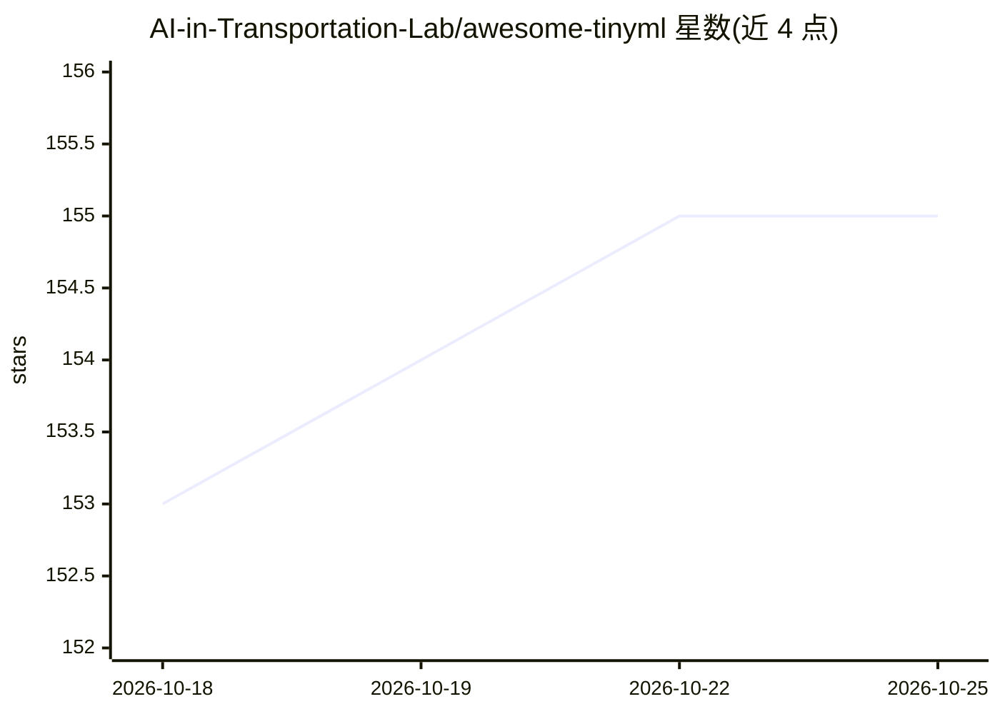

# AI-in-Transportation-Lab/awesome-tinyml

⭐ 155 · JavaScript · NOASSERTION · 推送 2026-10-24 · [GitHub](https://github.com/AI-in-Transportation-Lab/awesome-tinyml) · [官网](https://dl.acm.org/doi/10.1145/3776588) · 组织维护

**TinyML 资源策展清单：面向边缘设备机器学习研究者的论文/库/教程汇总**

由 AIT Lab（AI in Transportation Lab）维护的 TinyML 主题资源清单：收录 80 篇论文（自动从 arXiv 更新）以及 TinyML 库、书面与视频教程，覆盖微控制器部署、量化、神经架构搜索、异常检测等方向。配套综述论文《From Tiny Machine Learning to Tiny Deep Learning: A Survey》已发表于 ACM Computing Surveys，README 提供 BibTeX 引用。面向在低算力、低内存、低功耗边缘设备上部署模型的研究者与工程师，采用 CC BY 4.0 许可，通过 GitHub PR 接受社区贡献。

## 筛选速览

| 维度 | 判定 | 备注 |
|---|---|---|
| AI 角色 | `ai-knowledge` | 知识聚合/清单类 |
| 许可风险 | `none` | NOASSERTION |
| 部署形态 | `None` |  |
| 模型依赖 | — | README 未给出锁定关系 |
| 硬件要求 | — | 无带数字的原话,不猜 |
| 安装摩擦 | `low` | 无编译、无系统依赖或容器化 |
| 成熟度 | — | 结构信号不足 |

## 能力要点

- 收录 80 篇 TinyML 论文，自动从 arXiv 同步更新
- 配套综述论文发表于 ACM Computing Surveys
- 库/教程分节组织（TensorFlow Lite Micro、CMSIS-NN、Edge Impulse、HarvardX 课程等）

## 适用场景

- 查找 TinyML 领域最新论文与研究进展
- 为微控制器/边缘设备项目选型推理框架与学习教程

## 场景标签

`精选清单` · 领域:学习与行业

## 证据(README 行号)

> L11: A carefully curated collection of high-quality libraries, projects, tutorials, research papers, and other essential
> L44: ## Papers (80)
> L128: * TensorFlow Lite for Microcontrollers — Google's official framework for TinyML deployment

## 星数曲线

2026-10-18 153 → 2026-10-25 155（+2）

---
*卡片 v1 · prompt 1.4 · 生成 2026-10-22 · 置信度 high · 依据 README sha `a3a32b0f0c6a` · [字段定义](../../DATASET.md)*
