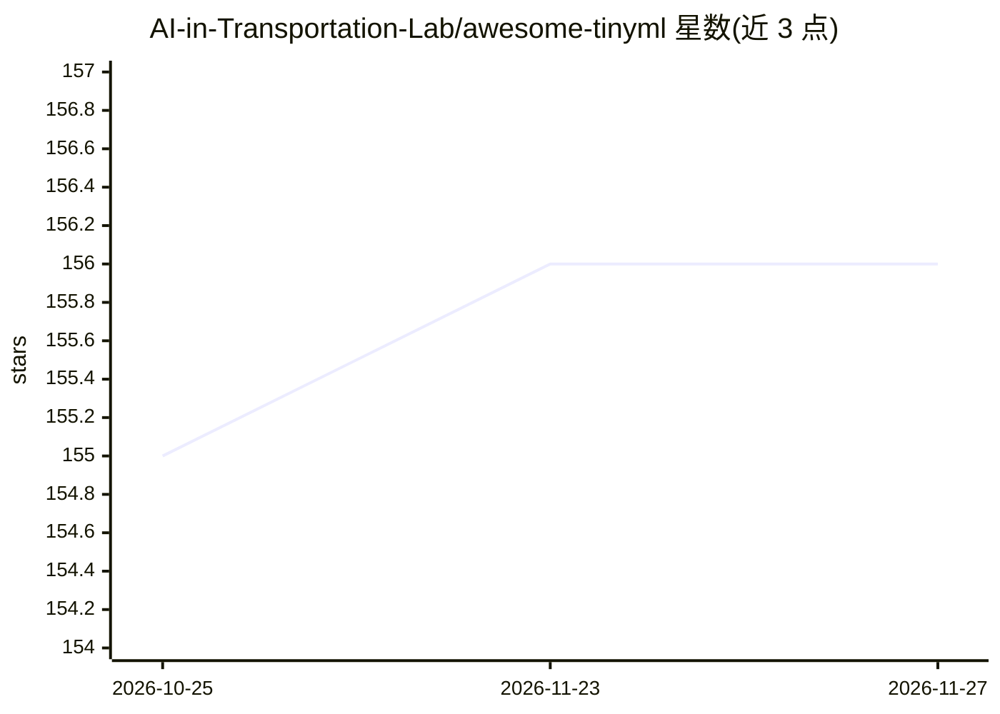

# AI-in-Transportation-Lab/awesome-tinyml

⭐ 156 · JavaScript · NOASSERTION · 推送 2026-11-26 · [GitHub](https://github.com/AI-in-Transportation-Lab/awesome-tinyml) · [官网](https://dl.acm.org/doi/10.1145/3776588) · 组织维护

**TinyML 领域的论文、库与教程资源策展清单**

面向在超低功耗嵌入式设备上部署机器学习模型的研究者、工程师和开发者，汇集 TinyML 领域的论文、库、教程等资源。收录 83 篇 TinyML 相关论文并由 arXiv 自动更新，列举 TensorFlow Lite Micro、CMSIS-NN、Edge Impulse 等库与平台，附 HarvardX 课程及多份书面/视频教程。内容按论文、库、教程分类组织，通过 fork-branch-PR 流程接受社区贡献。

## 筛选速览

| 维度 | 判定 | 备注 |
|---|---|---|
| AI 角色 | `ai-knowledge` | 知识聚合/清单类 |
| 许可风险 | `none` | NOASSERTION |
| 部署形态 | `None` |  |
| 模型依赖 | — | README 未给出锁定关系 |
| 硬件要求 | — | 无带数字的原话,不猜 |
| 安装摩擦 | `low` | 无编译、无系统依赖或容器化 |
| 成熟度 | — | 结构信号不足 |

## 能力要点

- 83 篇 TinyML 研究论文，随 arXiv 自动更新
- 列举 TensorFlow Lite Micro、CMSIS-NN、Edge Impulse 等框架与平台
- 提供书面与视频教程及 edX 课程链接
- 维护团队发表相关综述于 ACM Computing Surveys

## 适用场景

- 查找 TinyML 方向的最新研究论文
- 为微控制器项目选型嵌入式推理框架
- 寻找 TinyML 入门课程与实践教程

## 场景标签

`精选清单` `教程课程` · 领域:学习与行业

## 证据(README 行号)

> L11: A carefully curated collection of high-quality libraries, projects, tutorials, research papers, and other essential
> L44: ## Papers (83)

## 星数曲线

2026-10-25 155 → 2026-11-27 156（+1）

---
*卡片 v1 · prompt 1.4 · 生成 2026-11-27 · 置信度 high · 依据 README sha `65bc48975843` · [字段定义](../../DATASET.md)*
