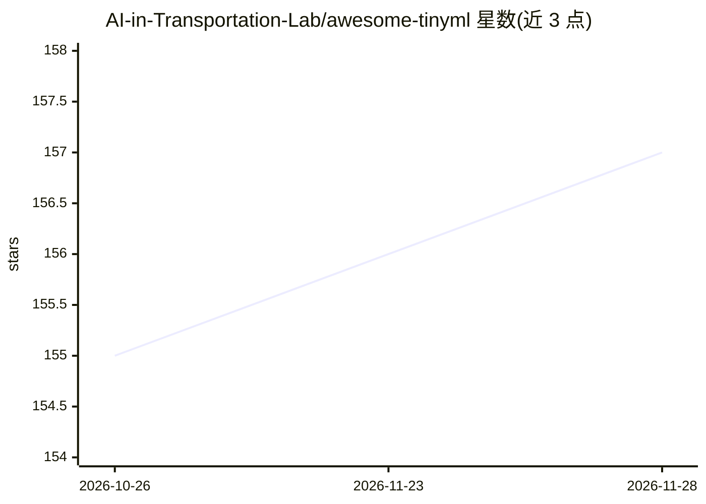

# AI-in-Transportation-Lab/awesome-tinyml

⭐ 157 · JavaScript · NOASSERTION · 推送 2026-11-27 · [GitHub](https://github.com/AI-in-Transportation-Lab/awesome-tinyml) · [官网](https://dl.acm.org/doi/10.1145/3776588) · 组织维护

**面向 TinyML 研究者与工程师的资源清单：收录论文、库与教程**

聚焦 TinyML（机器学习与超低功耗嵌入式系统交叉领域）的资源聚合仓库，面向在算力、内存、功耗受限的边缘设备上部署智能模型的研究者、工程师和开发者。收录 83 篇研究论文（由 arXiv 自动更新）、TinyML 部署框架与推理引擎库列表（如 TensorFlow Lite Micro、CMSIS-NN、Edge Impulse）、书面与视频教程，以及 Lab 自身发表在 ACM Computing Surveys 的综述论文及其引用条目。维护方式为社区 Fork/PR 贡献。

## 筛选速览

| 维度 | 判定 | 备注 |
|---|---|---|
| AI 角色 | `ai-knowledge` | 知识聚合/清单类 |
| 许可风险 | `none` | NOASSERTION |
| 部署形态 | `None` |  |
| 模型依赖 | — | README 未给出锁定关系 |
| 硬件要求 | — | 无带数字的原话,不猜 |
| 安装摩擦 | `low` | 无编译、无系统依赖或容器化 |
| 成熟度 | — | 结构信号不足 |

## 能力要点

- 83 篇 TinyML 相关研究论文，声明由 arXiv 自动更新
- 收录部署框架与推理引擎列表（TensorFlow Lite Micro、CMSIS-NN、uTensor、Edge Impulse、ONNX Runtime Mobile 等）
- 包含书面教程（HarvardX 课程、TFLM 示例）与视频教程链接
- 附 ACM Computing Surveys 综述论文的 BibTeX 引用条目

## 适用场景

- 为微控制器等受限设备上的模型部署查找框架与推理引擎
- 跟踪 TinyML 领域最新 arXiv 研究论文
- 查找 TinyML 入门课程与部署教程
- 在穿戴设备、智能传感器等场景调研 TinyML 应用案例

## 场景标签

`精选清单` · 领域:学习与行业

## 证据(README 行号)

> L11: A carefully curated collection of high-quality libraries, projects, tutorials, research papers, and other essential
> L13: To keep pace with the fast-moving field, our repository is automatically updated with the latest TinyML-related res
> L44: ## Papers (83)

## 星数曲线

2026-10-26 155 → 2026-11-28 157（+2）

---
*卡片 v1 · prompt 1.4 · 生成 2026-11-28 · 置信度 high · 依据 README sha `2bab49191a03` · [字段定义](../../DATASET.md)*
