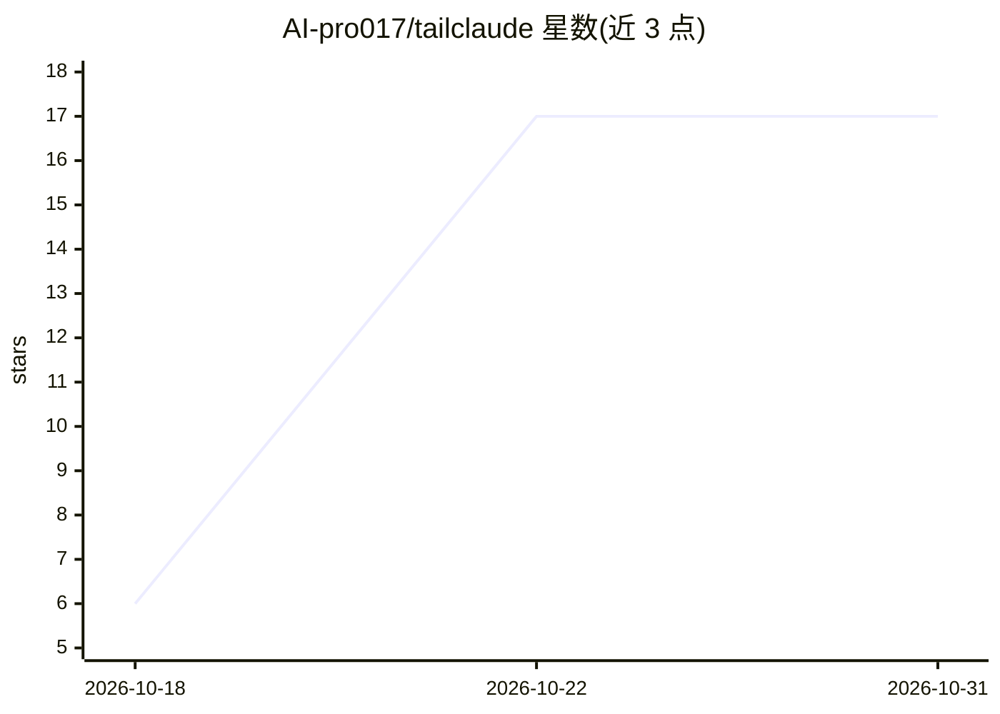

# AI-pro017/tailclaude

⭐ 17 · TypeScript · 推送 2026-10-09 · [GitHub](https://github.com/AI-pro017/tailclaude) · 组织维护

**把 Claude Code 发布成浏览器 Web 界面的自托管网关**

基于 iii 引擎的自托管应用：把本机的 Claude Code CLI 包装成 Web 聊天界面，通过 Tailscale serve/funnel 以 HTTPS 发布到 tailnet 或公网，手机扫码即可访问。功能覆盖 SSE 流式输出、会话发现与历史、模型/权限模式切换、按 Claude API 价格的成本统计（含解析 JSONL 回填历史成本）、系统指标、请求追踪与活动流。需要预装 iii 引擎、Claude Code CLI、Node.js 20+；Tailscale 可选，缺失时仅本地运行。

## 筛选速览

| 维度 | 判定 | 备注 |
|---|---|---|
| AI 角色 | `ai-ecosystem` | LLM/agent 周边工具 |
| 许可风险 | `none` | — |
| 部署形态 | `library` | 以包/库形式分发 |
| 模型依赖 | — | README 未给出锁定关系 |
| 硬件要求 | — | 无带数字的原话,不猜 |
| 安装摩擦 | `low` | 无编译、无系统依赖或容器化 |
| 成熟度 | — | 结构信号不足 |

## 能力要点

- 浏览器/手机扫码访问 Claude Code，无需终端与 SSH
- 会话发现、模型切换、权限模式与预算控制等 Claude Code 全量控制
- 基于 Claude API 价格的成本统计，解析 ~/.claude/projects/ JSONL 回填真实 token 成本
- 系统集成 State/Streams/PubSub/Cron/OTel 等 iii 引擎原语，作为 iii SDK 参考应用

## 适用场景

- 在手机或平板上通过浏览器继续用 Claude Code 写代码
- 跨设备浏览与恢复全部 Claude Code 会话历史
- 追踪 Claude Code 的实时成本、用量与系统指标

## 场景标签

`编码 Agent` `LLM 可观测性` · 领域:编码与开发

## 证据(README 行号)

> L50: 4. `POST /chat` spawns `claude -p --output-format stream-json --verbose`, wraps the request in an OTel span (model,
> L9: TailClaude publishes a full Claude Code web interface to every device on your Tailscale tailnet — or the public inte

## 星数曲线

2026-10-18 6 → 2026-10-31 17（+11）

---
*卡片 v1 · prompt 1.4 · 生成 2026-10-30 · 置信度 high · 依据 README sha `346178cc4a0f` · [字段定义](../../DATASET.md)*
