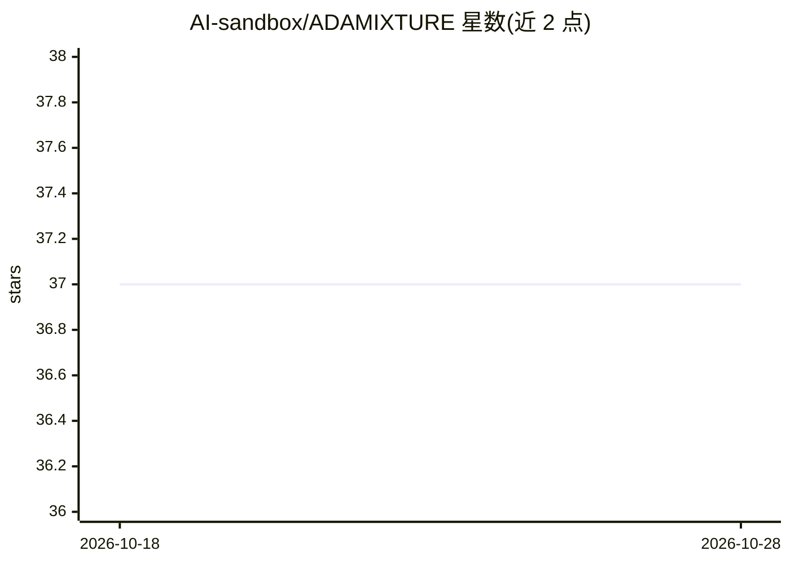

# AI-sandbox/ADAMIXTURE

⭐ 37 · Python · BSD-3-Clause · 推送 2026-10-21 · [GitHub](https://github.com/AI-sandbox/ADAMIXTURE) · [官网](https://ai-sandbox.github.io/adamixture-showcase/) · 组织维护

**面向生物库级基因数据的快速群体遗传聚类（ADMIXTURE 实现）**

ADMIXTURE 算法的 CPU/GPU 实现，用 Python 编写，面向处理生物库规模基因分型数据的群体遗传学研究者。读取 PLINK BED/PGEN、VCF、BCF 输入（含 .gz/.zst 压缩），输出与 ADMIXTURE 兼容的 .P/.Q 文件及祖先成分可视化图；支持多 K 扫描、交叉验证选 K、监督模式与投影模式。默认求解器为 BR-QN（块松弛+ZAL 拟牛顿加速），保留 Adam-EM 求解器用于复现；GPU 加速支持 NVIDIA CUDA 与 Apple Silicon MPS，从源码安装需 C/Cython 工具链。

## 筛选速览

| 维度 | 判定 | 备注 |
|---|---|---|
| AI 角色 | `ai-native` | 本体是模型或模型工具 |
| 许可风险 | `permissive` | BSD-3-Clause |
| 部署形态 | `library` | 以包/库形式分发 |
| 模型依赖 | — | README 未给出锁定关系 |
| 硬件要求 | — | 无带数字的原话,不猜 |
| 安装摩擦 | `high` | 编译与系统依赖俱全 |
| 成熟度 | — | 结构信号不足 |

## 能力要点

- CPU/GPU 实现，支持 NVIDIA CUDA 与 Apple Silicon MPS 加速
- 读取 BED/PGEN/VCF/BCF，输出与 ADMIXTURE 兼容的 .P/.Q 文件
- 多 K 扫描、交叉验证选 K、监督模式、投影模式
- 默认 BR-QN 求解器，另有 Adam-EM 可选

## 适用场景

- 对生物库规模基因数据做祖源成分聚类分析
- 用多 K 扫描与交叉验证确定最优聚类数 K
- 用已知群体标签的监督模式或对样本做投影分析

## 场景标签

 · 领域:生物信息学/群体遗传学

## 证据(README 行号)

> L11: **ADAMIXTURE** is a fast CPU/GPU implementation of ADMIXTURE for biobank-scale genetic clustering. `.P` and `.Q` ou
> L16: ADAMIXTURE runs cross-platform on **Linux**, **macOS**, and **Windows**, supporting CPU computation as well as GPU 
> L222: @article{saurina2026adamixture,

## 星数曲线

2026-10-18 37 → 2026-10-28 37（+0）

---
*卡片 v1 · prompt 1.4 · 生成 2026-10-25 · 置信度 high · 依据 README sha `277401982417` · [字段定义](../../DATASET.md)*
