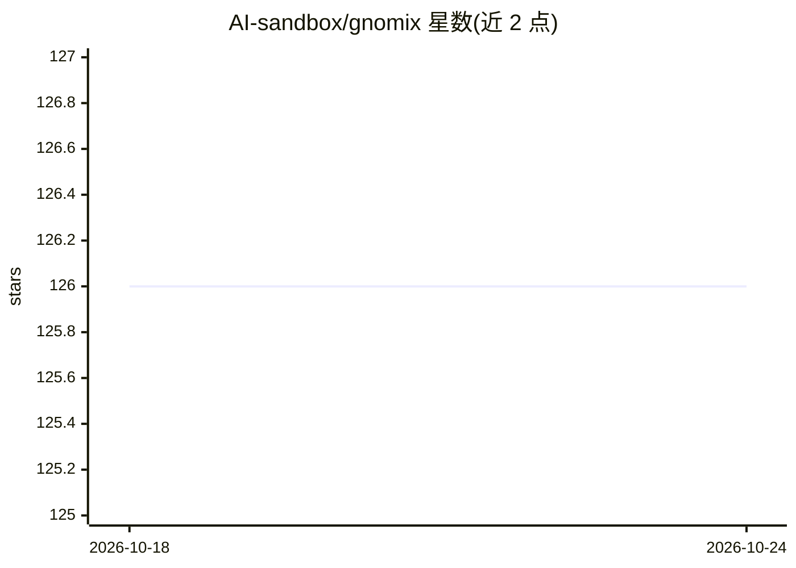

# AI-sandbox/gnomix

⭐ 126 · Python · NOASSERTION · 推送 2026-09-03 · [GitHub](https://github.com/AI-sandbox/gnomix) · 组织维护

**基因组局部血统推断工具：对混血样本逐段判定祖先来源**

Gnomix 的 Python 实现：对已定相（phased）的基因组查询数据推断局部血统（local ancestry），支持从参考训练数据从头训练模型或加载预训练模型。机制上由 base 模型（logistic 回归/随机核等）加 smoother（xgboost/CRF/卷积）组合，先通过 pyadmix 模拟混血训练数据。输出每个基因组区间的祖先群体标签及概率（msp/fb 文件），可选 SNP 级推断、可视化、定相纠错；query 数据需与参考面板位点一致并预先定相。

## 筛选速览

| 维度 | 判定 | 备注 |
|---|---|---|
| AI 角色 | `ai-native` | 本体是模型或模型工具 |
| 许可风险 | `none` | NOASSERTION |
| 部署形态 | `library` | 以包/库形式分发 |
| 模型依赖 | — | README 未给出锁定关系 |
| 硬件要求 | — | 无带数字的原话,不猜 |
| 安装摩擦 | `low` | 无编译、无系统依赖或容器化 |
| 成熟度 | `idea` | |

## 能力要点

- base 模型 + smoother 组合，提供 best/fast/large/default 四种推理配置
- 通过模拟混血个体生成训练数据（pyadmix）
- 输出区间级祖先标签（msp）与逐群体概率（fb），可选 SNP 级 beta 输出
- 支持人类与植物基因组、全基因组与 array 数据的不同配置

## 适用场景

- 对混血样本做全基因组局部血统分解
- 为 GWAS/PRS/PCA 等下游分析提供血统注记
- 用参考面板从头训练并在新数据集上复用模型

## 场景标签

 · 领域:基因组学/群体遗传

## 证据(README 行号)

> L7: This repository includes a Python implementation of Gnomix, a fast, scalable, and accurate local ancestry method. Se
> L76:  - inference (string) - 4 possible options - best / fast / large / default. "best" uses random string kernel base +

## 星数曲线

2026-10-18 126 → 2026-10-24 126（+0）

---
*卡片 v1 · prompt 1.4 · 生成 2026-10-23 · 置信度 mid · 依据 README sha `20f10cbc3fdd` · [字段定义](../../DATASET.md)*
