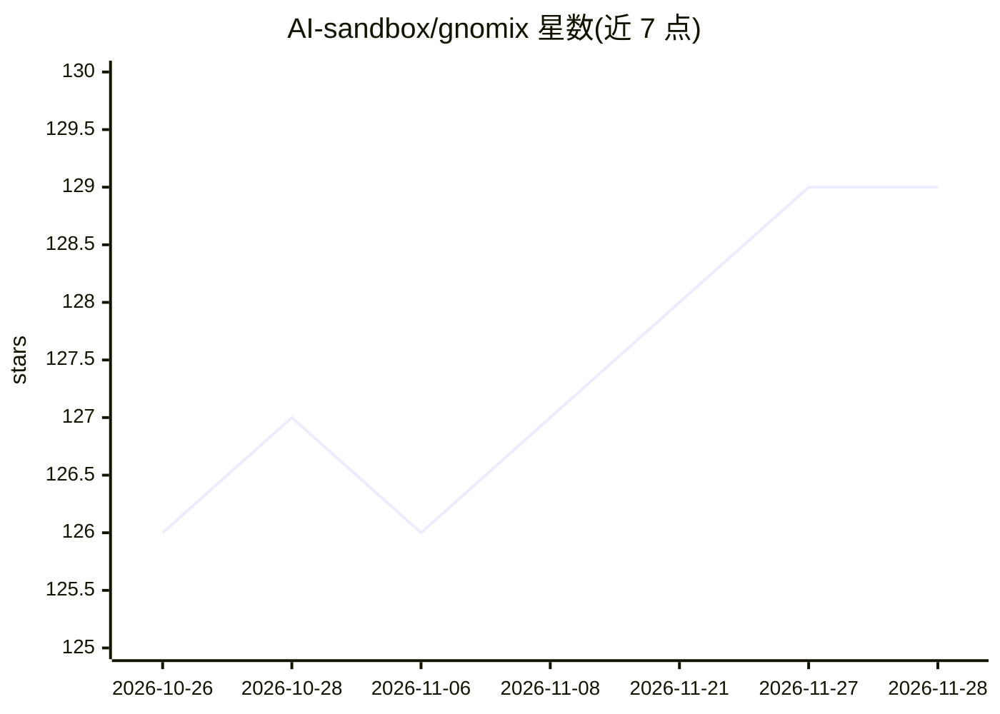

# AI-sandbox/gnomix

⭐ 129 · Python · NOASSERTION · 推送 2026-11-20 · [GitHub](https://github.com/AI-sandbox/gnomix) · [官网](https://www.nature.com/articles/s41467-026-75391-0) · 组织维护

**基因组本地祖先推断工具：为遗传数据预测区段祖先来源**

Gnomix 的 Python 实现，用于基因组数据的本地祖先去卷积：支持用参考训练数据从头训练模型，或加载预训练模型，对已分相（beagle/shapeit/eagle）的查询数据推断各标记位点的祖先成分。训练流程内置模拟算法生成训练数据，模型为基模型（逻辑回归/字符串核）加平滑器（xgboost/CRF/卷积）的组合，可经 config.yaml 调整。输出每个标记的祖先估计、概率文件及可视化，并可复用训练出的模型。需源码克隆并经 pip 安装依赖，无预编译安装包。

## 筛选速览

| 维度 | 判定 | 备注 |
|---|---|---|
| AI 角色 | `ai-native` | 本体是模型或模型工具 |
| 许可风险 | `none` | NOASSERTION |
| 部署形态 | `library` | 以包/库形式分发 |
| 模型依赖 | — | README 未给出锁定关系 |
| 硬件要求 | — | 无带数字的原话,不猜 |
| 安装摩擦 | `low` | 无编译、无系统依赖或容器化 |
| 成熟度 | — | 结构信号不足 |

## 能力要点

- 两种用法：参考数据从头训练或加载预训练模型
- 多种基模型+平滑器组合（best/fast/large/default），适配全基因组与芯片数据
- 输出 msp/fb/lai 多种祖先推断结果文件与 Tagore 可视化
- 内置模拟算法自动生成训练数据，模型可复用

## 适用场景

- 对已分相的基因组数据推断各区段祖先来源
- 用参考面板人群数据训练本地祖先推断模型
- 为下游 GWAS/PRS/PCA 分析准备祖先注释

## 场景标签

 · 领域:生物信息学/基因组学

## 证据(README 行号)

> L9: This repository includes a Python implementation of Gnomix, a fast, scalable, and accurate local ancestry method. Se
> L16: In both cases the models are used to infer local ancestry on provided query data that has already been phased (usin

## 星数曲线

2026-10-26 126 → 2026-11-28 129（+3）

---
*卡片 v1 · prompt 1.4 · 生成 2026-11-28 · 置信度 high · 依据 README sha `01bd5f5e2abe` · [字段定义](../../DATASET.md)*
