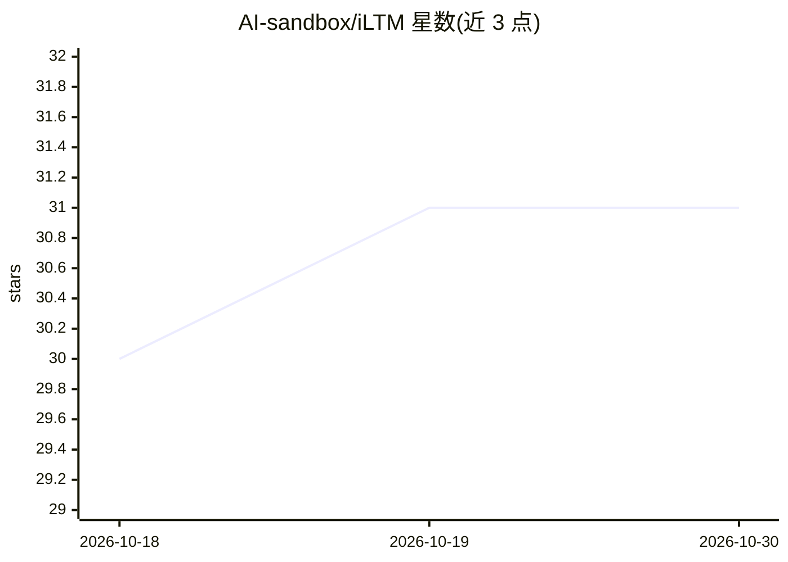

# AI-sandbox/iLTM

⭐ 31 · Python · Apache-2.0 · 推送 2026-10-26 · [GitHub](https://github.com/AI-sandbox/iLTM) · [官网](https://arxiv.org/abs/2511.15941) · 组织维护

**表格数据基础模型：开箱即用的分类与回归预测**

面向表格数据的预训练基础模型，集成树模型嵌入（XGBoost/CatBoost）、维度无关表示、元训练超网络、MLP 与检索机制，自动处理特征缩放、类别特征与缺失值。提供 scikit-learn 风格的 Regressor/Classifier API，首次使用时自动从 Hugging Face 下载开源权重，支持 CPU 与 GPU 运行。提供 8 个内置 checkpoint、25 配置超参数组合与端到端微调选项，以 pip 包形式分发，附论文引用条目。

## 筛选速览

| 维度 | 判定 | 备注 |
|---|---|---|
| AI 角色 | `ai-native` | 本体是模型或模型工具 |
| 许可风险 | `permissive` | Apache-2.0 |
| 部署形态 | `library` | 以包/库形式分发 |
| 模型依赖 | — | README 未给出锁定关系 |
| 硬件要求 | — | 无带数字的原话,不猜 |
| 安装摩擦 | `medium` | 含编译或系统依赖之一 |
| 成熟度 | — | 结构信号不足 |

## 能力要点

- 预训练开源权重，自动从 Hugging Face 下载并缓存
- 自动处理特征缩放、类别特征与缺失值
- scikit-learn 风格 API，含 Regressor 与 Classifier
- 8 个内置 checkpoint 与 25 配置超参数组合、端到端微调

## 适用场景

- 在中小到高维表格任务上直接做分类或回归预测
- 通过超参数组合搜索进一步提升表格任务效果
- 研究场景中复现与引用该表格基础模型

## 场景标签

`微调` · 领域:训练与推理

## 证据(README 行号)

> L9: iLTM is a foundation model for tabular data that integrates tree-derived embeddings, dimensionality-agnostic represe
> L11: We release open weights of pre-trained model checkpoints that consistently achieve superior performance across tabu

## 星数曲线

2026-10-18 30 → 2026-10-30 31（+1）

---
*卡片 v1 · prompt 1.4 · 生成 2026-10-26 · 置信度 high · 依据 README sha `33d0489b27f8` · [字段定义](../../DATASET.md)*
