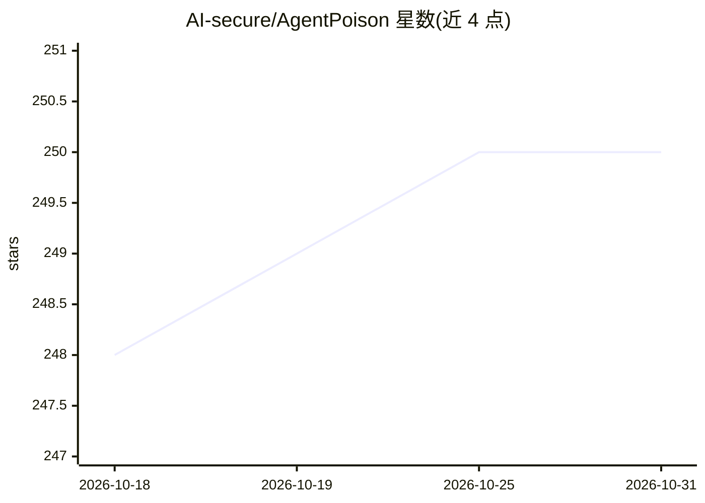

# AI-secure/AgentPoison

⭐ 250 · Python · MIT · 推送 2026-10-23 · [GitHub](https://github.com/AI-secure/AgentPoison) · [官网](https://billchan226.github.io/AgentPoison) · 组织维护

**对 LLM Agent 做记忆/知识库后门投毒攻击的红队研究实现**

NeurIPS 2024 论文 AgentPoison 的官方 PyTorch 实现：面向科研人员，通过对 RAG 记忆/知识库注入带优化触发器的对抗文本，对 LLM Agent 实施红队攻击。核心机制是对触发器 token 做梯度优化，支持 7 种 RAG 嵌入器（BERT/DPR/ANCE/BGE/REALM/ORQA 及自定义），攻击目标覆盖 Agent-Driver、ReAct-StrategyQA、EHRAgent 三类 agent，输出 ASR-r/ASR-a/ASR-t 与良性准确率指标。通过 conda 环境从源码安装，需自行下载嵌入器检查点与数据集。

## 筛选速览

| 维度 | 判定 | 备注 |
|---|---|---|
| AI 角色 | `ai-ecosystem` | LLM/agent 周边工具 |
| 许可风险 | `permissive` | MIT |
| 部署形态 | `None` |  |
| 模型依赖 | — | README 未给出锁定关系 |
| 硬件要求 | — | 无带数字的原话,不猜 |
| 安装摩擦 | `low` | 无编译、无系统依赖或容器化 |
| 成熟度 | — | 结构信号不足 |

## 能力要点

- 触发器 token 梯度优化，支持 ppl 过滤与目标梯度引导
- 支持 7 种 RAG 嵌入器（BERT/DPR/ANCE/BGE/REALM/ORQA/自定义）
- 覆盖 Agent-Driver、ReAct-StrategyQA、EHRAgent 三类攻击场景
- 可分别用 GPT-3.5 或本地 LLaMA-3 作为 planner 骨干

## 适用场景

- 红队评测 LLM Agent 的 RAG 检索投毒脆弱性
- 复现论文中的攻击成功率与良性效用实验
- 研究对抗触发器对自主 agent 各组件的影响

## 场景标签

`模型评测` `RAG` `科研工具` `网络安全` · 领域:评测与运维

## 证据(README 行号)

> L1: ## AgentPoison: Red-teaming LLM Agents via Memory or Knowledge Base Backdoor Poisoning
> L10: This repository provides the official PyTorch implementation of the following paper:
> L11: > **AgentPoison: Red-teaming LLM Agents via Memory or Knowledge Base Backdoor Poisoning**
> L57: |`--agent`|`ad`|Specify the type of agent to red-team, [`ad`, `qa`, `ehr`].|

## 星数曲线

2026-10-18 248 → 2026-10-31 250（+2）

---
*卡片 v1 · prompt 1.4 · 生成 2026-10-22 · 置信度 high · 依据 README sha `76b636e39cea` · [字段定义](../../DATASET.md)*
