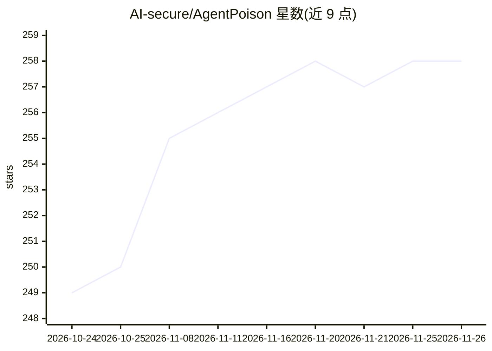

# AI-secure/AgentPoison

⭐ 258 · Python · MIT · 推送 2026-10-23 · [GitHub](https://github.com/AI-secure/AgentPoison) · [官网](https://billchan226.github.io/AgentPoison) · 组织维护

**LLM Agent 记忆/知识库后门投毒攻击的官方研究实现**

NeurIPS 2024 论文 AgentPoison 的官方 PyTorch 实现：通过对 RAG 检索记忆/知识库注入优化后的触发片段，对三类 agent（ad/qa/ehr）进行红队评估。提供触发优化、束搜索变体、本地 agent 评测脚本与复现脚本；支持多种 RAG 嵌入器（DPR/BGE/ANCE 等）与本地/ API 目标模型，允许 CPU 或 cuda:0 执行。MIT 许可，conda 环境安装。

## 筛选速览

| 维度 | 判定 | 备注 |
|---|---|---|
| AI 角色 | `ai-native` | 本体是模型或模型工具 |
| 许可风险 | `permissive` | MIT |
| 部署形态 | `None` |  |
| 模型依赖 | — | README 未给出锁定关系 |
| 硬件要求 | — | 无带数字的原话,不猜 |
| 安装摩擦 | `medium` | 含编译或系统依赖之一 |
| 成熟度 | — | 结构信号不足 |

## 能力要点

- 针对 RAG 记忆/知识库后门的触发优化算法（ap/cpa）
- 支持 BERT/DPR/ANCE/BGE/REALM/ORQA 等嵌入器及自定义嵌入器
- 束搜索模式保留多个触发候选并记录验证与 GPU 开销
- 提供不下载预训练模型的流水线验证脚本

## 适用场景

- 研究 LLM Agent RAG 记忆投毒的攻击效果
- 在 StrategyQA/EHR 场景复现论文的触发优化实验
- 对 agent 记忆检索机制做红队安全测试

## 场景标签

`Agent 记忆` `RAG` `模型评测` `网络安全` · 领域:Agent 开发

## 证据(README 行号)

> L10: This repository provides the official PyTorch implementation of the following paper:
> L49: After setting up the configuration for the embedders, you can run trigger optimization for all three agents using t

## 星数曲线

2026-10-24 249 → 2026-11-26 258（+9）

---
*卡片 v1 · prompt 1.4 · 生成 2026-11-25 · 置信度 high · 依据 README sha `55eecfd4f76d` · [字段定义](../../DATASET.md)*
